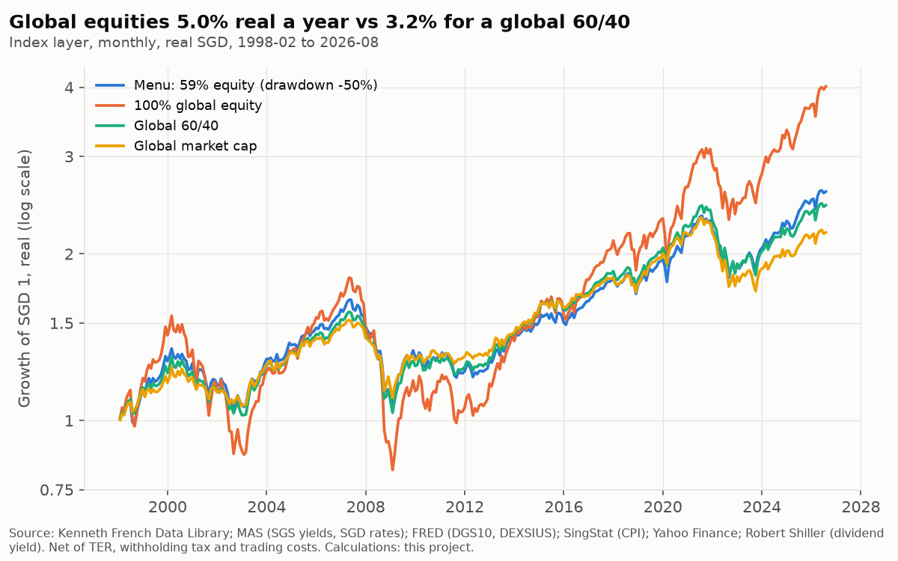
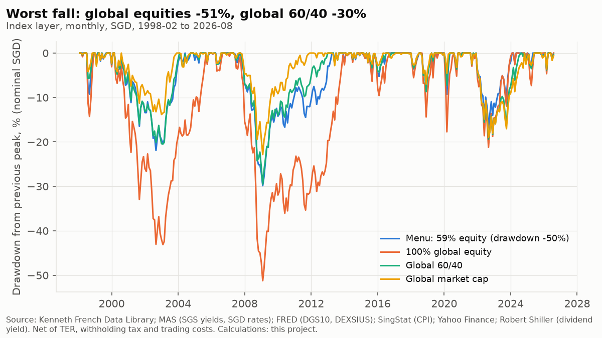

# Backtest results

Generated by `uv run python -m analysis.pipeline backtest`; do not edit by hand. Rules are in `src/analysis/backtest/engine.py` and `robustness.py` and were fixed before results were computed. Risk-free rate for Sharpe and Sortino: the SGD one-month rate (SORA Index from August 2005, compounded SGD interbank overnight before; MAS). All returns in SGD, net of fund TER, dividend withholding tax and trading costs at the USD 25,000 minimum; rebalancing every December and when a weight drifts more than 10 points.

**Status (2026-10-27):** no single recommended portfolio. The strategies below are the distinct mixes in the risk menu of `docs/strategy_design.md` (highest expected return for each maximum-drawdown tolerance): Menu: 59% equity (drawdown -50%). This result is not final.

**In-sample caveat:** the menu's drawdown test uses SGD history that overlaps this backtest (alongside US history before 1981), so these results are not out of sample.

Withholding-tax drag on equities in the index layer averaged 0.27% a year (trailing dividend yield x 15%). The ETF layer's fund prices already include TER and fund-level withholding tax.

## Index layer (1998-02 to 2026-08)

|  | annual_return | real_annual_return | volatility | sharpe | sortino | max_drawdown | recovery_months | turnover_per_year | cost_per_year | worst_1y | worst_3y | worst_5y | worst_10y |
|---|---|---|---|---|---|---|---|---|---|---|---|---|---|
| Menu: 59% equity (drawdown -50%) | 5.2% | 3.4% | 7.9% | 0.54 | 0.80 | -29.8% | 51 | 3.7% | 0.3% | -23.9% | -7.0% | -2.4% | 1.0% |
| 100% global equity | 6.8% | 5.0% | 13.5% | 0.48 | 0.68 | -51.2% | 60 | 0.0% | 0.0% | -41.6% | -16.8% | -7.2% | -2.2% |
| Global 60/40 | 5.0% | 3.2% | 7.8% | 0.52 | 0.75 | -29.5% | 47 | 4.1% | 0.7% | -24.3% | -7.3% | -2.0% | 0.7% |
| Global market cap | 4.5% | 2.8% | 6.8% | 0.53 | 0.78 | -22.8% | 34 | 4.2% | 0.7% | -19.4% | -4.9% | -0.9% | 1.5% |

Menu mixes against their drawdown tolerance on this layer's real SGD path:

|  | max_drawdown_real | tolerance | meets_tolerance |
|---|---|---|---|
| Menu: 59% equity (drawdown -50%) | -35.3% | -50.0% | True |

## ETF layer (2011-11 to 2026-08)

|  | annual_return | real_annual_return | volatility | sharpe | sortino | max_drawdown | recovery_months | turnover_per_year | cost_per_year | worst_1y | worst_3y | worst_5y | worst_10y |
|---|---|---|---|---|---|---|---|---|---|---|---|---|---|
| Menu: 59% equity (drawdown -50%) | 7.2% | 5.4% | 7.1% | 0.87 | 1.38 | -16.1% | 17 | 2.7% | 0.3% | -14.4% | 1.5% | 3.0% | 4.8% |
| 100% global equity | 11.3% | 9.4% | 11.3% | 0.92 | 1.45 | -19.6% | 16 | 0.0% | 0.0% | -18.9% | 2.4% | 3.6% | 7.7% |
| Global 60/40 | 6.5% | 4.7% | 7.1% | 0.78 | 1.21 | -17.0% | 18 | 2.7% | 0.7% | -17.0% | 0.5% | 2.3% | 4.3% |
| Global market cap | 5.4% | 3.6% | 6.2% | 0.72 | 1.10 | -16.4% | 19 | 2.8% | 0.7% | -16.4% | -0.3% | 1.8% | 3.6% |

Menu mixes against their drawdown tolerance on this layer's real SGD path:

|  | max_drawdown_real | tolerance | meets_tolerance |
|---|---|---|---|
| Menu: 59% equity (drawdown -50%) | -21.8% | -50.0% | True |

## Trading costs

Cost per side = half the bid-ask spread from a dated snapshot (`reference/spread_snapshot.csv`) + published broker and exchange fees (`reference/trading_costs.csv`), with 9% GST on Singapore-charged fees; fee minimums converted at the FX rates in `reference/fx_rates.csv`. Snapshot half-spreads: ISAC.L 0.8 bps; A35.SI 9.0 bps; IGLO.L 7.0 bps. Spread rows still to verify against an exchange or issuer quote: ISAC.L, IGLO.L; results that use them depend on that check. The SGD-to-USD conversion cost for LSE trades is not published and is excluded. The schedules are cost data only, not broker recommendations.

Cost of one buy order, as a fraction of the order, by order size:

|  | USD 1,000 | USD 2,500 | USD 5,000 | USD 10,000 | USD 25,000 |
|---|---|---|---|---|---|
| equity (ISAC.L, LSE) | 8.0% | 3.2% | 1.6% | 0.8% | 0.3% |
| bonds (A35.SI, SGX) | 0.3% | 0.2% | 0.2% | 0.2% | 0.2% |
| global_bonds (IGLO.L, LSE) | 8.1% | 3.3% | 1.7% | 0.9% | 0.4% |

Trading cost per year (index layer), base case and with every spread replaced by 5, 15 or 30 bps per side (fees unchanged):

|  | base_case | spread_5bps | spread_15bps | spread_30bps |
|---|---|---|---|---|
| Menu: 59% equity (drawdown -50%) | 0.3% | 0.3% | 0.3% | 0.4% |
| 100% global equity | 0.0% | 0.0% | 0.0% | 0.0% |
| Global 60/40 | 0.7% | 0.7% | 0.7% | 0.7% |
| Global market cap | 0.7% | 0.7% | 0.7% | 0.7% |

Rebalancing trades are sized from the USD 25,000 minimum, not the grown portfolio, so fixed minimum commissions weigh as they would at the minimum account size.

## Turnover per profile

One-way turnover from rebalancing, per year (a single-asset allocation never rebalances):

|  | index_layer_turnover_per_year | etf_layer_turnover_per_year |
|---|---|---|
| Menu: 59% equity (drawdown -50%) | 3.7% | 2.7% |

Turnover and trading cost per year for every equity/SGS mix on the frontier (index layer; 0% and 100% equity never rebalance). These apply to whichever mix a horizon's loss budget selects in `docs/strategy_design.md`:

|  | turnover_per_year | cost_per_year | cost_spread_5bps | cost_spread_15bps | cost_spread_30bps |
|---|---|---|---|---|---|
| 10% equity | 1.4% | 0.3% | 0.3% | 0.3% | 0.3% |
| 20% equity | 2.5% | 0.3% | 0.3% | 0.3% | 0.3% |
| 30% equity | 3.2% | 0.3% | 0.3% | 0.3% | 0.4% |
| 40% equity | 3.7% | 0.3% | 0.3% | 0.3% | 0.4% |
| 50% equity | 3.9% | 0.3% | 0.3% | 0.3% | 0.4% |
| 60% equity | 3.7% | 0.3% | 0.3% | 0.3% | 0.4% |
| 70% equity | 3.2% | 0.3% | 0.3% | 0.3% | 0.4% |
| 80% equity | 2.5% | 0.3% | 0.3% | 0.3% | 0.4% |
| 90% equity | 1.4% | 0.3% | 0.3% | 0.3% | 0.3% |

## Subperiods (index layer)

|  | 1998–2007 | 2008–2009 | 2010–2019 | 2020 | 2022 | 2023 to latest | 1998–2007 drawdown | 2008–2009 drawdown | 2010–2019 drawdown | 2020 drawdown | 2022 drawdown | 2023 to latest drawdown |
|---|---|---|---|---|---|---|---|---|---|---|---|---|
| Menu: 59% equity (drawdown -50%) | 5.5% | -4.7% | 5.5% | 11.3% | -14.1% | 11.9% | -21.9% | -24.7% | -8.2% | -9.3% | -13.6% | -5.0% |
| 100% global equity | 6.0% | -12.8% | 8.7% | 14.7% | -18.8% | 18.1% | -43.1% | -43.5% | -15.8% | -17.7% | -16.5% | -7.3% |
| Global 60/40 | 5.1% | -5.2% | 6.4% | 12.2% | -18.3% | 10.4% | -20.5% | -24.3% | -8.7% | -7.3% | -15.7% | -6.9% |
| Global market cap | 4.9% | -3.4% | 5.9% | 11.7% | -18.0% | 8.5% | -13.8% | -19.1% | -7.0% | -4.6% | -15.5% | -6.8% |

## Rising-rate era and long history (global JST portfolio, real USD, annual)

1950–1981 is the post-war period of rising long-term rates to the 1981 peak; 1871–2020 includes both world wars. Global bonds hedged to USD stand in for SGS.

|  | real_annual_return | max_drawdown |
|---|---|---|
| ('Menu: 59% equity (drawdown -50%)', '1950–1981') | 3.9% | -20.7% |
| ('Menu: 59% equity (drawdown -50%)', '1871–2020') | 5.4% | -50.4% |
| ('100% global equity', '1950–1981') | 6.3% | -26.4% |
| ('100% global equity', '1871–2020') | 6.3% | -56.7% |
| ('Global 60/40', '1950–1981') | 4.0% | -20.8% |
| ('Global 60/40', '1871–2020') | 5.5% | -50.5% |
| ('Global market cap', '1950–1981') | 3.3% | -20.1% |
| ('Global market cap', '1871–2020') | 5.2% | -49.1% |

## Forward outcomes (10-year, block bootstrap of the index layer, real SGD)

|  | p5 | median | p95 | share_below_zero |
|---|---|---|---|---|
| Menu: 59% equity (drawdown -50%) | -1.1% | 3.4% | 7.7% | 10.9% |

## Parameter grid (index layer, each menu mix against its drawdown tolerance)

|  | real_annual_return | volatility | max_drawdown | cost_per_year | max_drawdown_real | meets_tolerance |
|---|---|---|---|---|---|---|
| ('Menu: 59% equity (drawdown -50%)', 'Base case') | 3.4% | 7.9% | -29.8% | 0.3% | -35.3% | True |
| ('Menu: 59% equity (drawdown -50%)', 'Equity -10%') | 3.0% | 6.7% | -23.9% | 0.3% | -29.6% | True |
| ('Menu: 59% equity (drawdown -50%)', 'Equity +10%') | 3.8% | 9.2% | -35.5% | 0.3% | -40.6% | True |
| ('Menu: 59% equity (drawdown -50%)', 'Band 5%') | 3.2% | 8.0% | -31.1% | 0.4% | -36.4% | True |
| ('Menu: 59% equity (drawdown -50%)', 'Band 15%') | 3.4% | 7.9% | -28.7% | 0.3% | -34.2% | True |
| ('Menu: 59% equity (drawdown -50%)', 'Calendar only') | 3.4% | 7.9% | -28.7% | 0.3% | -34.2% | True |
| ('Menu: 59% equity (drawdown -50%)', 'Global hedged bonds') | 3.1% | 7.7% | -28.9% | 0.7% | -33.7% | True |
| ('Menu: 59% equity (drawdown -50%)', 'Global unhedged bonds') | 3.2% | 7.5% | -26.7% | 0.7% | -32.4% | True |
| ('Menu: 59% equity (drawdown -50%)', 'Spread 5 bps per side') | 3.4% | 7.9% | -29.8% | 0.3% | -35.3% | True |
| ('Menu: 59% equity (drawdown -50%)', 'Spread 15 bps per side') | 3.4% | 7.9% | -29.9% | 0.3% | -35.3% | True |
| ('Menu: 59% equity (drawdown -50%)', 'Spread 30 bps per side') | 3.4% | 7.9% | -29.9% | 0.4% | -35.3% | True |

Variants that fail: none.

## What drove returns

Annualised sleeve returns over the index layer: equities 6.8%, SGS 2.6%, SGD cash 1.1% (nominal SGD). The 10-year SGS yield fell from 5.30% at the start to 0.81% (2020-10) and ended at 2.35%: much of the bond return came from falling yields, which cannot repeat from today's starting level.

## Caveats

- About 28 years of SGD history; the ETF layer starts in November 2011 and has no 2008 crisis.
- Index-layer equities are developed markets only (no emerging markets before the ETF layer); the withholding-tax drag uses the 15% treaty rate on the whole dividend yield, an approximation.
- Spreads are a single dated snapshot; spreads widen in stressed markets, which the 5/15/30 bps sensitivity covers only partly.
- Benchmark global bonds use US Treasuries hedged to SGD before July 2019, with no fund fee.
