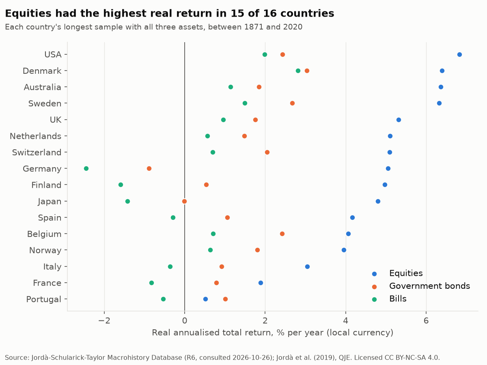
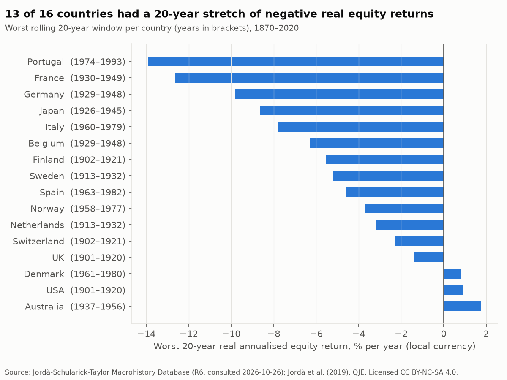
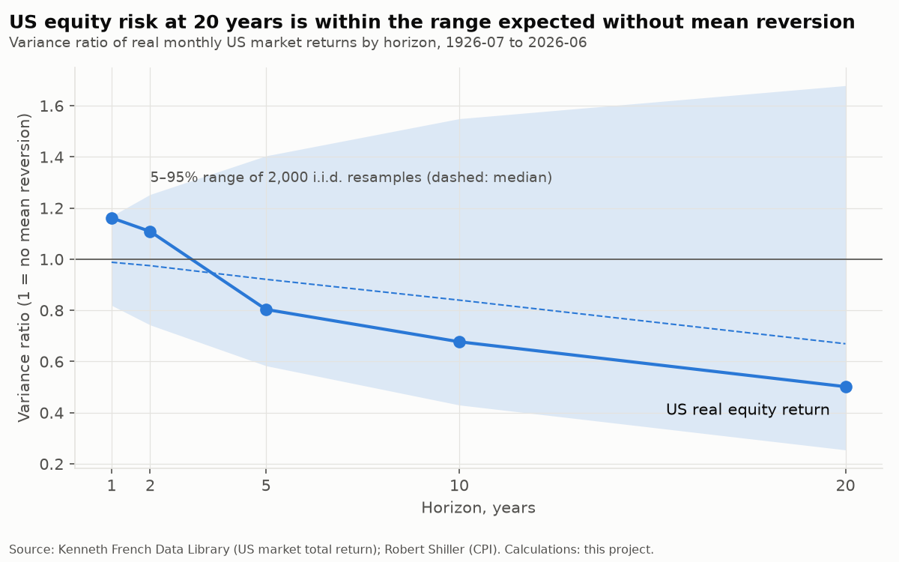
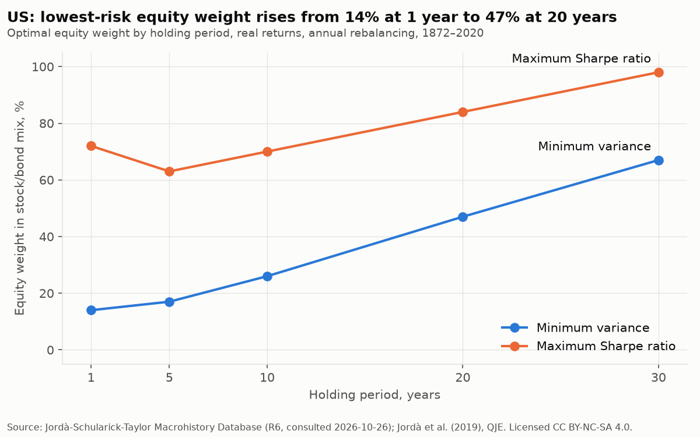
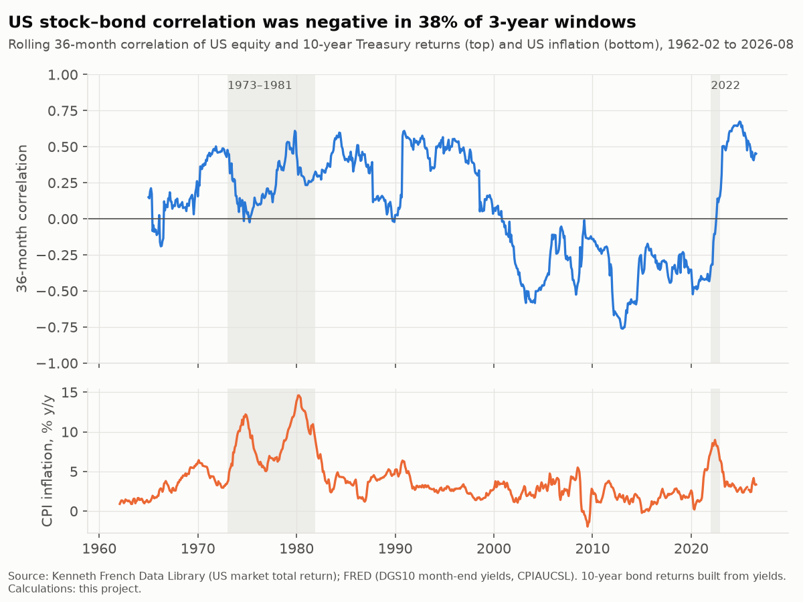

# Evidence review

Generated by `uv run python -m analysis.pipeline evidence`; do not edit by hand. Verdicts follow fixed rules: a claim *holds* if true in every case tested, *partially holds* if true in more than half, and *fails* otherwise (see `analysis.evidence.verdict_from_share`).

| # | Claim | Verdict |
|---|---|---|
| 1 | Equities have the highest long-run real return across countries, not only in the US. | Partially holds |
| 2 | US equities have had no negative real annualised return over any rolling 20-year window. Tested across countries, not just the US. | Fails |
| 3 | Equity volatility of annualised returns falls with horizon faster than i.i.d. returns would imply (mean reversion). | Fails |
| 4 | A minimum-risk stock/bond mix shifts towards equities as the horizon lengthens. | Partially holds |
| 5 | Bonds diversify equities. | Fails |

## Claim 1: Equities have the highest long-run real return across countries, not only in the US.

**Verdict: Partially holds.** Among financial assets, equities had the highest real return in 15 of 16 countries (not in: Portugal). Including housing, equities came first in 2 of 16.

**Data.** Jordà-Schularick-Taylor Macrohistory Database R6 (annual, local currency, nominal total returns and CPI), 1871–2020. Canada and Ireland lack a year with equity, bond and bill returns all present and are excluded.

**Method.** Real return each year = (1 + nominal return) / (1 + inflation) - 1. Geometric annualised real return per asset on each country's common sample. Housing is compared on the years where all four assets exist.

**Findings**

- Equities beat government bonds and bills in 15 of 16 countries.
- US equities returned 6.8% a year in real terms, ranked 1 of 16. The other 15 countries averaged 4.5% (equal-weighted; range 0.5% to 6.4%).
- Housing (rent included) had the highest real return in 14 of 16 countries on the four-asset sample.

**Caveats**

- Survivorship: the JST countries are developed markets that kept functioning. Markets that were wiped out (e.g. Russia after 1917, China after 1949) are absent, so cross-country equity returns are biased upward. Jorion and Goetzmann (1999, Journal of Finance 54(3)) document this; cited, not independently verified.
- Years missing inside a country's sample are skipped, not filled: Denmark (1915); Australia (1945 1946 1947); Switzerland (1915); Germany (1923 1944 1945 1946 1947 1948 1949); Japan (1946 1947); Spain (1936 1937 1938 1939 1940 2018); Belgium (1914 1915 1916 1917 1918 1919); Italy (1872 1873 1874 1875 1876 1877 1878 1879 1880 1881 1882 1883 1884 1915 1916 1917 1918 1919 1920 1921); France (1915 1916 1917 1918 1919 1920 1921). If losses were concentrated in those years, the returns shown are too high.
- Housing returns are estimates for an unlevered, undiversified, illiquid asset that cannot be bought as an index. They are reported for context, are not comparable to investable index returns, and are never used as a proxy for REITs.
- Local-currency returns: they answer 'what did a local investor earn', not what an SGD investor would have earned.

Table: financial assets

|  | start | end | years | missing_years | equity | bonds | bills | highest |
|---|---|---|---|---|---|---|---|---|
| USA | 1872 | 2020 | 149 |  | 6.8% | 2.4% | 2.0% | equity |
| Denmark | 1875 | 2020 | 145 | 1915 | 6.4% | 3.0% | 2.8% | equity |
| Australia | 1900 | 2020 | 118 | 1945 1946 1947 | 6.4% | 1.8% | 1.1% | equity |
| Sweden | 1871 | 2020 | 150 |  | 6.3% | 2.7% | 1.5% | equity |
| UK | 1871 | 2020 | 150 |  | 5.3% | 1.8% | 1.0% | equity |
| Netherlands | 1900 | 2020 | 121 |  | 5.1% | 1.5% | 0.6% | equity |
| Switzerland | 1900 | 2020 | 120 | 1915 | 5.1% | 2.0% | 0.7% | equity |
| Germany | 1871 | 2020 | 143 | 1923 1944 1945 1946 1947 1948 1949 | 5.1% | -0.9% | -2.4% | equity |
| Finland | 1896 | 2020 | 125 |  | 5.0% | 0.5% | -1.6% | equity |
| Japan | 1886 | 2020 | 133 | 1946 1947 | 4.8% | -0.0% | -1.4% | equity |
| Spain | 1900 | 2020 | 115 | 1936 1937 1938 1939 1940 2018 | 4.2% | 1.1% | -0.3% | equity |
| Belgium | 1871 | 2020 | 144 | 1914 1915 1916 1917 1918 1919 | 4.1% | 2.4% | 0.7% | equity |
| Norway | 1881 | 2020 | 140 |  | 3.9% | 1.8% | 0.6% | equity |
| Italy | 1871 | 2020 | 130 | 1872 1873 1874 1875 1876 1877 1878 1879 1880 1881 1882 1883 1884 1915 1916 1917 1918 1919 1920 1921 | 3.0% | 0.9% | -0.4% | equity |
| France | 1871 | 2020 | 143 | 1915 1916 1917 1918 1919 1920 1921 | 1.9% | 0.8% | -0.8% | equity |
| Portugal | 1880 | 2020 | 141 |  | 0.5% | 1.0% | -0.5% | bonds |

Table: with housing

|  | start | end | years | missing_years | equity | bonds | bills | housing | highest |
|---|---|---|---|---|---|---|---|---|---|
| USA | 1891 | 2020 | 130 |  | 6.8% | 2.0% | 1.4% | 5.9% | equity |
| Australia | 1901 | 2020 | 117 | 1945 1946 1947 | 6.3% | 1.9% | 1.1% | 5.9% | equity |
| Denmark | 1876 | 2020 | 144 | 1915 | 6.3% | 3.0% | 2.7% | 8.0% | housing |
| Sweden | 1883 | 2020 | 138 |  | 6.3% | 2.5% | 1.3% | 7.8% | housing |
| Finland | 1920 | 2020 | 99 | 1927 1945 | 6.0% | 3.2% | -0.3% | 8.4% | housing |
| Netherlands | 1900 | 2020 | 121 |  | 5.1% | 1.5% | 0.6% | 7.0% | housing |
| Switzerland | 1902 | 2020 | 118 | 1915 | 5.1% | 2.0% | 0.6% | 5.6% | housing |
| Germany | 1871 | 2020 | 116 | 1915 1916 1917 1918 1919 1920 1921 1922 1923 1924 1939 1940 1941 1942 1943 1944 1945 1946 1947 1948 1949 1950 1951 1952 1953 1954 1955 1956 1957 1958 1959 1960 1961 1962 | 5.1% | 3.8% | 2.4% | 7.4% | housing |
| UK | 1896 | 2020 | 118 | 1940 1941 1942 1943 1944 1945 1946 | 4.9% | 1.2% | 0.9% | 5.0% | housing |
| Japan | 1931 | 2020 | 75 | 1945 1946 1947 1948 1949 1950 1951 1952 1953 1954 1955 1956 1957 1958 1959 | 4.4% | 2.1% | 0.2% | 6.3% | housing |
| Spain | 1901 | 2020 | 114 | 1936 1937 1938 1939 1940 2018 | 4.2% | 1.0% | -0.3% | 4.5% | housing |
| Belgium | 1890 | 2020 | 114 | 1914 1915 1916 1917 1918 1919 1965 1966 1967 1968 1969 1970 1971 1972 1973 1974 1975 | 4.2% | 2.2% | 0.2% | 7.8% | housing |
| Norway | 1881 | 2020 | 140 |  | 3.9% | 1.8% | 0.6% | 7.6% | housing |
| Italy | 1928 | 2020 | 86 | 1939 1940 1941 1942 1943 1944 1945 | 3.6% | 2.7% | 1.1% | 4.3% | housing |
| France | 1871 | 2020 | 143 | 1915 1916 1917 1918 1919 1920 1921 | 1.9% | 0.8% | -0.8% | 6.7% | housing |
| Portugal | 1948 | 2020 | 73 |  | -0.7% | 0.3% | -0.7% | 6.3% | housing |

## Claim 2: US equities have had no negative real annualised return over any rolling 20-year window. Tested across countries, not just the US.

**Verdict: Fails.** US: 1 negative windows out of 1626 (worst -0.2% a year, ending 1921-06). Across 16 countries, 13 had at least one negative 20-year window; the cross-country version fails.

**Data.** US: Robert Shiller online data, monthly, from 1871 (S&P Composite with dividends, CPI). Other countries: JST Macrohistory Database R6, annual, 1870–2020.

**Method.** Real total return, compounded over every overlapping 20-year window and annualised. US windows step monthly; JST windows step annually and must contain 20 consecutive years of data.

**Findings**

- US, 1626 monthly windows ending 1891-01 to 2026-06: worst -0.2% a year (window ending 1921-06), 1 negative.
- Sensitivity: on JST annual US data (calendar-year windows) the US had 0 negative windows; worst 0.9% a year, ending 1920. The verdict depends on how close the worst US window is to zero, so it is sensitive to data source and window timing.
- 13 of 16 countries had at least one negative 20-year real window. Worst: Portugal, -13.9% a year over 1974–1993.
- Countries with negative windows: Portugal (45 of 131), France (59 of 131), Germany (25 of 131), Japan (7 of 95), Italy (43 of 131), Belgium (34 of 131), Finland (16 of 106), Sweden (18 of 131), Spain (18 of 102), Norway (26 of 121), Netherlands (9 of 102), Switzerland (8 of 102), UK (2 of 131).

**Caveats**

- Overlapping windows share most of their years, so the number of windows overstates the number of independent observations: 150 years hold fewer than 8 separate 20-year periods.
- The US record is one country's history, and the US had the highest equity return of the 16 countries in claim 1. Its result shouldn't be generalised.
- Survivorship (see claim 1): markets that were wiped out are not in the data.
- Local currency, before costs and taxes.

Table: countries

|  | windows | negative_windows | share_negative | worst | worst_window_end |
|---|---|---|---|---|---|
| Portugal | 131 | 45 | 34.4% | -13.9% | 1993 |
| France | 131 | 59 | 45.0% | -12.6% | 1949 |
| Germany | 131 | 25 | 19.1% | -9.8% | 1948 |
| Japan | 95 | 7 | 7.4% | -8.6% | 1945 |
| Italy | 131 | 43 | 32.8% | -7.8% | 1979 |
| Belgium | 131 | 34 | 26.0% | -6.3% | 1948 |
| Finland | 106 | 16 | 15.1% | -5.6% | 1921 |
| Sweden | 131 | 18 | 13.7% | -5.2% | 1932 |
| Spain | 102 | 18 | 17.6% | -4.6% | 1982 |
| Norway | 121 | 26 | 21.5% | -3.7% | 1977 |
| Netherlands | 102 | 9 | 8.8% | -3.2% | 1932 |
| Switzerland | 102 | 8 | 7.8% | -2.3% | 1921 |
| UK | 131 | 2 | 1.5% | -1.4% | 1920 |
| Denmark | 129 | 0.0% | 0.0% | 0.8% | 1980 |
| USA | 130 | 0.0% | 0.0% | 0.9% | 1920 |
| Australia | 131 | 0.0% | 0.0% | 1.8% | 1956 |

Table: us summary

|  | us_rolling_20y |
|---|---|
| count | 1626 |
| mean | 6.7% |
| std | 2.9% |
| min | -0.2% |
| 25% | 4.7% |
| 50% | 6.8% |
| 75% | 8.6% |
| max | 13.6% |

## Claim 3: Equity volatility of annualised returns falls with horizon faster than i.i.d. returns would imply (mean reversion).

**Verdict: Fails.** Mean reversion at 20 years is statistically supported in 0 of 16 countries. US (monthly, 1926-07 to 2026-06): variance ratio 0.50 against an i.i.d. 5–95% range of 0.25–1.68.

**Data.** US: Kenneth French Data Library market total return (monthly) deflated by Shiller CPI. Other countries: JST Macrohistory Database R6 real equity returns (annual), longest run of consecutive years per country (at least 60).

**Method.** Variance ratio VR(k): variance of overlapping k-period real log returns divided by k times the one-period variance. VR = 1 under i.i.d. returns. Each market is compared with 2,000 i.i.d. resamples of its own returns (fixed seed). Mean reversion counts as supported if the 20-year VR is below the resamples' 5th percentile.

**Findings**

- US 20-year variance ratio 0.50; 31% of i.i.d. resamples were lower. Not distinguishable from i.i.d. at the 5% level.
- 10 of 16 countries have a 20-year variance ratio below the i.i.d. median (the direction mean reversion predicts); 0 are below the 5th percentile.
- Variance ratios below 1 are expected even with no mean reversion: the i.i.d. median at 20 years is 0.67 for the US sample, because overlapping windows in a finite sample bias the ratio down.

**Caveats**

- With 16 countries tested at the 5% level, about one false positive is expected by chance.
- Overlapping 20-year windows in 60–150 years of data give few independent observations; the bootstrap range is wide for this reason.
- The i.i.d. bootstrap removes all time dependence, including volatility clustering, which can affect the variance ratio's distribution. A block bootstrap would be a robustness check.
- Background: Poterba and Summers (1988, Journal of Financial Economics) reported mean reversion; Lo and MacKinlay (1988, Review of Financial Studies) developed the variance-ratio test. Cited, not independently verified.

Table: us

| horizon | variance_ratio | iid_p5 | iid_median | iid_p95 | share_of_iid_below |
|---|---|---|---|---|---|
| 12 | 116.2% | 82.0% | 98.8% | 116.8% | 94.2% |
| 24 | 110.9% | 74.3% | 97.5% | 125.3% | 79.7% |
| 60 | 80.4% | 58.3% | 92.1% | 140.4% | 29.8% |
| 120 | 67.7% | 43.0% | 84.0% | 1.5 | 29.4% |
| 240 | 50.2% | 25.4% | 67.0% | 1.7 | 31.0% |

Table: countries

|  | start | end | vr_10y | vr_20y | iid_p5_20y | iid_median_20y | supported |
|---|---|---|---|---|---|---|---|
| Germany | 1871 | 2020 | 54.6% | 39.4% | 39.0% | 81.2% | False |
| Denmark | 1873 | 2020 | 46.6% | 40.9% | 36.8% | 79.0% | False |
| Australia | 1871 | 2020 | 60.7% | 45.0% | 39.4% | 80.5% | False |
| USA | 1872 | 2020 | 68.6% | 45.1% | 37.0% | 80.5% | False |
| Italy | 1871 | 2020 | 83.1% | 48.8% | 37.6% | 80.0% | False |
| UK | 1871 | 2020 | 72.1% | 55.8% | 38.5% | 80.3% | False |
| Switzerland | 1900 | 2020 | 80.3% | 59.7% | 32.1% | 73.7% | False |
| Belgium | 1871 | 2020 | 74.5% | 70.5% | 38.8% | 78.6% | False |
| Finland | 1896 | 2020 | 87.5% | 73.8% | 33.3% | 77.7% | False |
| Norway | 1881 | 2020 | 75.1% | 77.0% | 36.2% | 78.1% | False |
| Netherlands | 1900 | 2020 | 92.5% | 80.8% | 31.5% | 75.2% | False |
| Spain | 1900 | 2020 | 132.7% | 96.4% | 32.8% | 75.8% | False |
| Portugal | 1871 | 2020 | 132.5% | 104.0% | 37.4% | 80.3% | False |
| Sweden | 1871 | 2020 | 92.5% | 104.1% | 39.1% | 79.9% | False |
| Japan | 1948 | 2020 | 129.4% | 113.8% | 18.5% | 55.3% | False |
| France | 1871 | 2020 | 1.6 | 1.6 | 37.2% | 78.6% | False |

## Claim 4: A minimum-risk stock/bond mix shifts towards equities as the horizon lengthens.

**Verdict: Partially holds.** The minimum-variance equity weight was higher at 20 years than at 1 year in 13 of 16 countries; in 7 the shift exceeded the 95th percentile of i.i.d. resamples. US: 14% → 47%.

**Data.** JST Macrohistory Database R6, annual real total returns on equities, government bonds and bills, each country's longest run of consecutive years with all three (at least 60 years). Local currency.

**Method.** Stock/bond mixes from 0% to 100% equity in 1-point steps, rebalanced annually. For each holding period, the standard deviation of overlapping annualised real returns (minimum variance) and the Sharpe ratio over bills (maximum Sharpe) pick the optimal weight. The 1→20-year shift is compared with 2,000 i.i.d. resamples of whole years.

**Findings**

- US 1872–2020: minimum-variance equity weight 14% at 1 year and 47% at 20 years; maximum-Sharpe weight 72% and 84%.
- Shift beyond the i.i.d. 95th percentile in 7 of 16 countries: Finland, Australia, Italy, Denmark, France, UK, USA.
- The two definitions answer different questions: minimum variance ignores return, while maximum Sharpe trades return against risk. A rising minimum-variance weight says equities became relatively less risky over long windows in real terms, not that they are riskless.
- Tables in popular books (e.g. Siegel, Stocks for the Long Run) report the minimum-standard-deviation mix by holding period; cited, not independently verified.

**Caveats**

- Long horizons rest on few independent periods: 20-year windows in about 120–150 years give 6–7 non-overlapping observations, so the 20-year weights are imprecise.
- Real returns in local currency: bonds look riskier in real terms in countries with high inflation episodes, which pushes the result towards equities there.
- Survivorship and missing years as in claim 1.
- No costs, taxes or currency effects for an SGD investor.

Table: countries

|  | start | end | mv_1y | mv_20y | ms_1y | ms_20y | shift | iid_shift_p95 | shift_beyond_iid |
|---|---|---|---|---|---|---|---|---|---|
| Finland | 1896 | 2020 | 10.0% | 100.0% | 34.0% | 78.0% | 90.0% | 39.0% | True |
| Australia | 1948 | 2020 | 16.0% | 100.0% | 50.0% | 78.0% | 84.0% | 39.0% | True |
| Italy | 1922 | 2020 | 8.0% | 89.0% | 36.0% | 43.0% | 81.0% | 47.0% | True |
| Denmark | 1916 | 2020 | 28.0% | 100.0% | 59.0% | 100.0% | 72.0% | 32.0% | True |
| France | 1922 | 2020 | 6.0% | 78.0% | 30.0% | 49.0% | 72.0% | 52.0% | True |
| UK | 1871 | 2020 | 11.0% | 79.0% | 100.0% | 91.0% | 68.0% | 35.0% | True |
| USA | 1872 | 2020 | 14.0% | 47.0% | 72.0% | 84.0% | 33.0% | 22.0% | True |
| Portugal | 1880 | 2020 | 13.0% | 41.0% | 23.0% | 42.0% | 28.0% | 37.0% | False |
| Netherlands | 1900 | 2020 | 14.0% | 33.0% | 42.0% | 58.0% | 19.0% | 25.0% | False |
| Switzerland | 1916 | 2020 | 3.0% | 21.0% | 21.0% | 35.0% | 18.0% | 26.0% | False |
| Japan | 1948 | 2020 | 12.0% | 24.0% | 19.0% | 28.0% | 12.0% | 32.0% | False |
| Sweden | 1871 | 2020 | 18.0% | 24.0% | 48.0% | 72.0% | 6.0% | 24.0% | False |
| Belgium | 1920 | 2020 | 7.0% | 10.0% | 19.0% | 54.0% | 3.0% | 40.0% | False |
| Spain | 1941 | 2017 | 0.0% | 0.0% | 59.0% | 100.0% | 0.0% | 37.0% | False |
| Germany | 1950 | 2020 | 1.0% | 0.0% | 14.0% | 9.0% | -1.0% | 16.0% | False |
| Norway | 1881 | 2020 | 10.0% | 0.0% | 24.0% | 82.0% | -10.0% | 25.0% | False |

Table: us by horizon

|  | min_variance | max_sharpe |
|---|---|---|
| 1 | 14.0% | 72.0% |
| 5 | 17.0% | 63.0% |
| 10 | 26.0% | 70.0% |
| 20 | 47.0% | 84.0% |
| 30 | 67.0% | 98.0% |

## Claim 5: Bonds diversify equities.

**Verdict: Fails.** US stock–bond correlation was negative in 279 of 740 rolling 3-year windows (38%). It was 0.28 over 1962–1999, -0.34 over 2000–2021 and 0.55 since 2022.

**Data.** US: Kenneth French market total return and a 10-year constant-maturity Treasury return built from FRED month-end yields (DGS10), monthly from February 1962; FRED CPIAUCSL for inflation. Cross-country: JST Macrohistory Database R6, annual real returns.

**Method.** Rolling 36-month Pearson correlation of monthly nominal returns. Correlation by inflation tercile (trailing 12-month CPI). Bond returns in the worst 5% of equity months. JST: correlation of annual real returns, split at each country's median inflation.

**Findings**

- US correlation by inflation tercile: low (-2.0% to 2.4%): -0.22; middle (2.5% to 4.0%): 0.14; high (4.0% to 14.6%): 0.29.
- Episodes: 1973–1981: 0.24; 2022: 0.60; 2022-01 to 2026-08: 0.55.
- Definition used for the verdict: bonds 'diversify' in the strong sense of hedging (negative correlation). In the weak sense, correlation below 1, they diversified in every window: the highest 3-year correlation was 0.67 (2024-12).
- In the worst 5% of US equity months, 10-year Treasuries had a positive return 54% of the time.
- Across 16 JST countries (annual, real), the full-sample correlation was negative in 1; correlation was higher in high-inflation years than in low-inflation years in 13 of 16.

**Caveats**

- Inflation terciles are defined on the full sample, so the regime split is descriptive and in-sample, not a forecasting rule.
- Correlation measures co-movement, not size: a low correlation with a small bond return does little to offset a large equity loss.
- The 10-year bond return is built from yields (par bond, semi-annual coupons), not a traded index; it matched Damodaran's annual 10-year returns with correlation 0.99 over 1963–2025.
- Nominal USD. For an SGD investor, currency hedging changes the bond leg (claim 12).

Table: us by inflation tercile

|  | months | inflation_range | correlation |
|---|---|---|---|
| low | 258 | -2.0% to 2.4% | -21.8% |
| middle | 258 | 2.5% to 4.0% | 13.8% |
| high | 258 | 4.0% to 14.6% | 29.4% |

Table: us episodes

|  | correlation |
|---|---|
| 1973–1981 | 23.9% |
| 2022 | 59.6% |
| 2022-01 to 2026-08 | 54.7% |

Table: countries

|  | years | corr_all | corr_high_inflation | corr_low_inflation |
|---|---|---|---|---|
| Germany | 145 | -7.3% | -14.4% | 6.6% |
| Netherlands | 121 | 9.5% | 23.2% | -15.3% |
| Denmark | 147 | 16.7% | 27.2% | -24.4% |
| USA | 149 | 19.2% | 30.0% | -6.6% |
| Sweden | 150 | 22.1% | 33.5% | -7.4% |
| Norway | 140 | 24.4% | 27.3% | 5.4% |
| Australia | 121 | 24.5% | 11.8% | 35.2% |
| Finland | 125 | 31.2% | 32.5% | 13.4% |
| Switzerland | 120 | 34.4% | 47.1% | 20.9% |
| Belgium | 144 | 39.2% | 35.1% | 35.8% |
| Japan | 133 | 39.9% | 48.3% | 26.3% |
| Italy | 150 | 43.0% | 42.2% | 34.0% |
| Portugal | 150 | 45.7% | 44.5% | 34.1% |
| Spain | 117 | 45.9% | 44.5% | 38.4% |
| UK | 150 | 47.1% | 51.4% | 35.5% |
| France | 150 | 48.3% | 57.4% | 17.3% |

