# Evidence review

Generated by `uv run python -m analysis.pipeline evidence`; do not edit by hand. Verdicts follow fixed rules: a claim *holds* if true in every case tested, *partially holds* if true in more than half, and *fails* otherwise (see `analysis.evidence.verdict_from_share`).

| # | Claim | Verdict |
|---|---|---|
| 1 | Equities have the highest long-run real return across countries, not only in the US. | Partially holds |
| 2 | US equities have had no negative real annualised return over any rolling 20-year window. Tested across countries, not just the US. | Fails |
| 3 | Equity volatility of annualised returns falls with horizon faster than i.i.d. returns would imply (mean reversion). | Fails |
| 4 | A minimum-risk stock/bond mix shifts towards equities as the horizon lengthens. | Partially holds |
| 5 | Bonds diversify equities. | Fails |
| 6 | Long-dated bonds earn a reliable term premium over intermediate bonds. | Partially holds |
| 7 | Corporate bonds earn a credit premium, and carry some equity-like risk. | Holds |
| 8 | Inflation-linked bonds hedge inflation. | Partially holds |
| 9 | Real estate earns long-run returns comparable to equities (listed REITs tested; housing reported separately). | Fails |
| 10 | Missing the best days destroys returns. | Holds |
| 11 | Rebalancing reduces volatility and drawdown. | Holds |
| 12 | Long-run real returns are similar hedged and unhedged (SGD investor; equities and bonds analysed separately). | Holds |
| 13 | Investors underperform the funds they invest in. | Not testable with our data |

## Claim 1: Equities have the highest long-run real return across countries, not only in the US.

**Verdict: Partially holds.** Among financial assets, equities had the highest real return in 15 of 16 countries (not in: Portugal). Including housing, equities came first in 2 of 16.

**Data.** Jordà-Schularick-Taylor Macrohistory Database R6 (annual, local currency, nominal total returns and CPI), 1871–2020. Canada and Ireland lack a year with equity, bond and bill returns all present and are excluded.

**Method.** Real return each year = (1 + nominal return) / (1 + inflation) - 1. Geometric annualised real return per asset on each country's common sample. Housing is compared on the years where all four assets exist.

**Findings**

- Equities beat government bonds and bills in 15 of 16 countries.
- US equities returned 6.8% a year in real terms, ranked 1 of 16. The other 15 countries averaged 4.5% (equal-weighted; range 0.5% to 6.4%).
- Housing (rent included) had the highest real return in 14 of 16 countries on the four-asset sample.

**Caveats**

- Survivorship: the JST countries are developed markets that kept functioning. Markets that were wiped out (e.g. Russia after 1917, China after 1949) are absent, so cross-country equity returns are biased upward. Jorion and Goetzmann (1999, Journal of Finance 54(3), 'Global Stock Markets in the Twentieth Century') document this with 39 markets: US real returns were well above the median market's over 1921–1996.
- Years missing inside a country's sample are skipped, not filled: Denmark (1915); Australia (1945 1946 1947); Switzerland (1915); Germany (1923 1944 1945 1946 1947 1948 1949); Japan (1946 1947); Spain (1936 1937 1938 1939 1940 2018); Belgium (1914 1915 1916 1917 1918 1919); Italy (1872 1873 1874 1875 1876 1877 1878 1879 1880 1881 1882 1883 1884 1915 1916 1917 1918 1919 1920 1921); France (1915 1916 1917 1918 1919 1920 1921). If losses were concentrated in those years, the returns shown are too high.
- Housing returns are estimates for an unlevered, undiversified, illiquid asset that cannot be bought as an index. They are reported for context, are not comparable to investable index returns, and are never used as a proxy for REITs.
- Local-currency returns: they answer 'what did a local investor earn', not what an SGD investor would have earned.

Table: financial assets

|  | start | end | years | missing_years | equity | bonds | bills | highest |
|---|---|---|---|---|---|---|---|---|
| USA | 1872 | 2020 | 149 |  | 6.8% | 2.4% | 2.0% | equity |
| Denmark | 1875 | 2020 | 145 | 1915 | 6.4% | 3.0% | 2.8% | equity |
| Australia | 1900 | 2020 | 118 | 1945 1946 1947 | 6.4% | 1.8% | 1.1% | equity |
| Sweden | 1871 | 2020 | 150 |  | 6.3% | 2.7% | 1.5% | equity |
| UK | 1871 | 2020 | 150 |  | 5.3% | 1.8% | 1.0% | equity |
| Netherlands | 1900 | 2020 | 121 |  | 5.1% | 1.5% | 0.6% | equity |
| Switzerland | 1900 | 2020 | 120 | 1915 | 5.1% | 2.0% | 0.7% | equity |
| Germany | 1871 | 2020 | 143 | 1923 1944 1945 1946 1947 1948 1949 | 5.1% | -0.9% | -2.4% | equity |
| Finland | 1896 | 2020 | 125 |  | 5.0% | 0.5% | -1.6% | equity |
| Japan | 1886 | 2020 | 133 | 1946 1947 | 4.8% | -0.0% | -1.4% | equity |
| Spain | 1900 | 2020 | 115 | 1936 1937 1938 1939 1940 2018 | 4.2% | 1.1% | -0.3% | equity |
| Belgium | 1871 | 2020 | 144 | 1914 1915 1916 1917 1918 1919 | 4.1% | 2.4% | 0.7% | equity |
| Norway | 1881 | 2020 | 140 |  | 3.9% | 1.8% | 0.6% | equity |
| Italy | 1871 | 2020 | 130 | 1872 1873 1874 1875 1876 1877 1878 1879 1880 1881 1882 1883 1884 1915 1916 1917 1918 1919 1920 1921 | 3.0% | 0.9% | -0.4% | equity |
| France | 1871 | 2020 | 143 | 1915 1916 1917 1918 1919 1920 1921 | 1.9% | 0.8% | -0.8% | equity |
| Portugal | 1880 | 2020 | 141 |  | 0.5% | 1.0% | -0.5% | bonds |

Table: with housing

|  | start | end | years | missing_years | equity | bonds | bills | housing | highest |
|---|---|---|---|---|---|---|---|---|---|
| USA | 1891 | 2020 | 130 |  | 6.8% | 2.0% | 1.4% | 5.9% | equity |
| Australia | 1901 | 2020 | 117 | 1945 1946 1947 | 6.3% | 1.9% | 1.1% | 5.9% | equity |
| Denmark | 1876 | 2020 | 144 | 1915 | 6.3% | 3.0% | 2.7% | 8.0% | housing |
| Sweden | 1883 | 2020 | 138 |  | 6.3% | 2.5% | 1.3% | 7.8% | housing |
| Finland | 1920 | 2020 | 99 | 1927 1945 | 6.0% | 3.2% | -0.3% | 8.4% | housing |
| Netherlands | 1900 | 2020 | 121 |  | 5.1% | 1.5% | 0.6% | 7.0% | housing |
| Switzerland | 1902 | 2020 | 118 | 1915 | 5.1% | 2.0% | 0.6% | 5.6% | housing |
| Germany | 1871 | 2020 | 116 | 1915 1916 1917 1918 1919 1920 1921 1922 1923 1924 1939 1940 1941 1942 1943 1944 1945 1946 1947 1948 1949 1950 1951 1952 1953 1954 1955 1956 1957 1958 1959 1960 1961 1962 | 5.1% | 3.8% | 2.4% | 7.4% | housing |
| UK | 1896 | 2020 | 118 | 1940 1941 1942 1943 1944 1945 1946 | 4.9% | 1.2% | 0.9% | 5.0% | housing |
| Japan | 1931 | 2020 | 75 | 1945 1946 1947 1948 1949 1950 1951 1952 1953 1954 1955 1956 1957 1958 1959 | 4.4% | 2.1% | 0.2% | 6.3% | housing |
| Spain | 1901 | 2020 | 114 | 1936 1937 1938 1939 1940 2018 | 4.2% | 1.0% | -0.3% | 4.5% | housing |
| Belgium | 1890 | 2020 | 114 | 1914 1915 1916 1917 1918 1919 1965 1966 1967 1968 1969 1970 1971 1972 1973 1974 1975 | 4.2% | 2.2% | 0.2% | 7.8% | housing |
| Norway | 1881 | 2020 | 140 |  | 3.9% | 1.8% | 0.6% | 7.6% | housing |
| Italy | 1928 | 2020 | 86 | 1939 1940 1941 1942 1943 1944 1945 | 3.6% | 2.7% | 1.1% | 4.3% | housing |
| France | 1871 | 2020 | 143 | 1915 1916 1917 1918 1919 1920 1921 | 1.9% | 0.8% | -0.8% | 6.7% | housing |
| Portugal | 1948 | 2020 | 73 |  | -0.7% | 0.3% | -0.7% | 6.3% | housing |

## Claim 2: US equities have had no negative real annualised return over any rolling 20-year window. Tested across countries, not just the US.

**Verdict: Fails.** US: 1 negative windows out of 1626 (worst -0.2% a year, ending 1921-06). Across 16 countries, 13 had at least one negative 20-year window; the cross-country version fails.

**Data.** US: Robert Shiller online data, monthly, from 1871 (S&P Composite with dividends, CPI). Other countries: JST Macrohistory Database R6, annual, 1870–2020.

**Method.** Real total return, compounded over every overlapping 20-year window and annualised. US windows step monthly; JST windows step annually and must contain 20 consecutive years of data.

**Findings**

- US, 1626 monthly windows ending 1891-01 to 2026-06: worst -0.2% a year (window ending 1921-06), 1 negative.
- Sensitivity: on JST annual US data (calendar-year windows) the US had 0 negative windows; worst 0.9% a year, ending 1920. The verdict depends on how close the worst US window is to zero, so it is sensitive to data source and window timing.
- 13 of 16 countries had at least one negative 20-year real window. Worst: Portugal, -13.9% a year over 1974–1993.
- Countries with negative windows: Portugal (45 of 131), France (59 of 131), Germany (25 of 131), Japan (7 of 95), Italy (43 of 131), Belgium (34 of 131), Finland (16 of 106), Sweden (18 of 131), Spain (18 of 102), Norway (26 of 121), Netherlands (9 of 102), Switzerland (8 of 102), UK (2 of 131).

**Caveats**

- Overlapping windows share most of their years, so the number of windows overstates the number of independent observations: 150 years hold fewer than 8 separate 20-year periods.
- The US record is one country's history, and the US had the highest equity return of the 16 countries in claim 1. Its result shouldn't be generalised.
- Survivorship (see claim 1): markets that were wiped out are not in the data.
- Local currency, before costs and taxes.

*Source: Jordà-Schularick-Taylor Macrohistory Database (R6, consulted 2026-10-26); Jordà et al. (2019), QJE. Licensed CC BY-NC-SA 4.0. Applies to the JST-derived figures and tables above.*

Table: countries

|  | windows | negative_windows | share_negative | worst | worst_window_end |
|---|---|---|---|---|---|
| Portugal | 131 | 45 | 34.4% | -13.9% | 1993 |
| France | 131 | 59 | 45.0% | -12.6% | 1949 |
| Germany | 131 | 25 | 19.1% | -9.8% | 1948 |
| Japan | 95 | 7 | 7.4% | -8.6% | 1945 |
| Italy | 131 | 43 | 32.8% | -7.8% | 1979 |
| Belgium | 131 | 34 | 26.0% | -6.3% | 1948 |
| Finland | 106 | 16 | 15.1% | -5.6% | 1921 |
| Sweden | 131 | 18 | 13.7% | -5.2% | 1932 |
| Spain | 102 | 18 | 17.6% | -4.6% | 1982 |
| Norway | 121 | 26 | 21.5% | -3.7% | 1977 |
| Netherlands | 102 | 9 | 8.8% | -3.2% | 1932 |
| Switzerland | 102 | 8 | 7.8% | -2.3% | 1921 |
| UK | 131 | 2 | 1.5% | -1.4% | 1920 |
| Denmark | 129 | 0.0% | 0.0% | 0.8% | 1980 |
| USA | 130 | 0.0% | 0.0% | 0.9% | 1920 |
| Australia | 131 | 0.0% | 0.0% | 1.8% | 1956 |

Table: us summary

|  | us_rolling_20y |
|---|---|
| count | 1626 |
| mean | 6.7% |
| std | 2.9% |
| min | -0.2% |
| 25% | 4.7% |
| 50% | 6.8% |
| 75% | 8.6% |
| max | 13.6% |

## Claim 3: Equity volatility of annualised returns falls with horizon faster than i.i.d. returns would imply (mean reversion).

**Verdict: Fails.** Mean reversion at 20 years is statistically supported in 0 of 16 countries. US (monthly, 1926-07 to 2026-06): variance ratio 0.50 against an i.i.d. 5–95% range of 0.25–1.68.

**Data.** US: Kenneth French Data Library market total return (monthly) deflated by Shiller CPI. Other countries: JST Macrohistory Database R6 real equity returns (annual), longest run of consecutive years per country (at least 60).

**Method.** Variance ratio VR(k): variance of overlapping k-period real log returns divided by k times the one-period variance. VR = 1 under i.i.d. returns. Each market is compared with 2,000 i.i.d. resamples of its own returns (fixed seed). Mean reversion counts as supported if the 20-year VR is below the resamples' 5th percentile.

**Findings**

- US 20-year variance ratio 0.50; 31% of i.i.d. resamples were lower. Not distinguishable from i.i.d. at the 5% level.
- 10 of 16 countries have a 20-year variance ratio below the i.i.d. median (the direction mean reversion predicts); 0 are below the 5th percentile.
- Variance ratios below 1 are expected even with no mean reversion: the i.i.d. median at 20 years is 0.67 for the US sample, because overlapping windows in a finite sample bias the ratio down.

**Caveats**

- With 16 countries tested at the 5% level, about one false positive is expected by chance.
- Overlapping 20-year windows in 60–150 years of data give few independent observations; the bootstrap range is wide for this reason.
- The i.i.d. bootstrap removes all time dependence, including volatility clustering, which can affect the variance ratio's distribution. A block bootstrap would be a robustness check.
- Background: Poterba and Summers (1988, Journal of Financial Economics 22(1)) found point estimates consistent with mean reversion in the US and 17 other countries, but could not reject the random walk at conventional levels, which is the same pattern found here. Lo and MacKinlay (1988, Review of Financial Studies 1(1)) developed the variance-ratio test.

*Source: Jordà-Schularick-Taylor Macrohistory Database (R6, consulted 2026-10-26); Jordà et al. (2019), QJE. Licensed CC BY-NC-SA 4.0. Applies to the JST-derived figures and tables above.*

Table: us

| horizon | variance_ratio | iid_p5 | iid_median | iid_p95 | share_of_iid_below |
|---|---|---|---|---|---|
| 12 | 1.16 | 0.82 | 0.99 | 1.17 | 0.94 |
| 24 | 1.11 | 0.74 | 0.97 | 1.25 | 0.80 |
| 60 | 0.80 | 0.58 | 0.92 | 1.40 | 0.30 |
| 120 | 0.68 | 0.43 | 0.84 | 1.55 | 0.29 |
| 240 | 0.50 | 0.25 | 0.67 | 1.68 | 0.31 |

Table: countries

|  | start | end | vr_10y | vr_20y | iid_p5_20y | iid_median_20y | supported |
|---|---|---|---|---|---|---|---|
| Germany | 1871 | 2020 | 0.55 | 0.39 | 0.39 | 0.81 | False |
| Denmark | 1873 | 2020 | 0.47 | 0.41 | 0.37 | 0.79 | False |
| Australia | 1871 | 2020 | 0.61 | 0.45 | 0.39 | 0.80 | False |
| USA | 1872 | 2020 | 0.69 | 0.45 | 0.37 | 0.81 | False |
| Italy | 1871 | 2020 | 0.83 | 0.49 | 0.38 | 0.80 | False |
| UK | 1871 | 2020 | 0.72 | 0.56 | 0.38 | 0.80 | False |
| Switzerland | 1900 | 2020 | 0.80 | 0.60 | 0.32 | 0.74 | False |
| Belgium | 1871 | 2020 | 0.74 | 0.71 | 0.39 | 0.79 | False |
| Finland | 1896 | 2020 | 0.87 | 0.74 | 0.33 | 0.78 | False |
| Norway | 1881 | 2020 | 0.75 | 0.77 | 0.36 | 0.78 | False |
| Netherlands | 1900 | 2020 | 0.93 | 0.81 | 0.32 | 0.75 | False |
| Spain | 1900 | 2020 | 1.33 | 0.96 | 0.33 | 0.76 | False |
| Portugal | 1871 | 2020 | 1.33 | 1.04 | 0.37 | 0.80 | False |
| Sweden | 1871 | 2020 | 0.93 | 1.04 | 0.39 | 0.80 | False |
| Japan | 1948 | 2020 | 1.29 | 1.14 | 0.19 | 0.55 | False |
| France | 1871 | 2020 | 1.56 | 1.55 | 0.37 | 0.79 | False |

## Claim 4: A minimum-risk stock/bond mix shifts towards equities as the horizon lengthens.

**Verdict: Partially holds.** The minimum-variance equity weight was higher at 20 years than at 1 year in 13 of 16 countries; in 7 the shift exceeded the 95th percentile of i.i.d. resamples. US: 14% → 47%.

**Data.** JST Macrohistory Database R6, annual real total returns on equities, government bonds and bills, each country's longest run of consecutive years with all three (at least 60 years). Local currency.

**Method.** Stock/bond mixes from 0% to 100% equity in 1-point steps, rebalanced annually. For each holding period, the standard deviation of overlapping annualised real returns (minimum variance) and the Sharpe ratio over bills (maximum Sharpe) pick the optimal weight. The 1→20-year shift is compared with 2,000 i.i.d. resamples of whole years.

**Findings**

- US 1872–2020: minimum-variance equity weight 14% at 1 year and 47% at 20 years; maximum-Sharpe weight 72% and 84%.
- Shift beyond the i.i.d. 95th percentile in 7 of 16 countries: Finland, Australia, Italy, Denmark, France, UK, USA.
- The two definitions answer different questions: minimum variance ignores return, while maximum Sharpe trades return against risk. A rising minimum-variance weight says equities became relatively less risky over long windows in real terms, not that they are riskless.
- The claim is usually stated with minimum-risk tables by holding period; we could not confirm which definition any specific published table uses, so none is cited. Both definitions are reported here.

**Caveats**

- Long horizons rest on few independent periods: 20-year windows in about 120–150 years give 6–7 non-overlapping observations, so the 20-year weights are imprecise.
- Real returns in local currency: bonds look riskier in real terms in countries with high inflation episodes, which pushes the result towards equities there.
- Survivorship and missing years as in claim 1.
- No costs, taxes or currency effects for an SGD investor.

*Source: Jordà-Schularick-Taylor Macrohistory Database (R6, consulted 2026-10-26); Jordà et al. (2019), QJE. Licensed CC BY-NC-SA 4.0. Applies to the JST-derived figures and tables above.*

Table: countries

|  | start | end | mv_1y | mv_20y | ms_1y | ms_20y | shift | iid_shift_p95 | shift_beyond_iid |
|---|---|---|---|---|---|---|---|---|---|
| Finland | 1896 | 2020 | 10.0% | 100.0% | 34.0% | 78.0% | 90.0% | 0.39 | True |
| Australia | 1948 | 2020 | 16.0% | 100.0% | 50.0% | 78.0% | 84.0% | 0.39 | True |
| Italy | 1922 | 2020 | 8.0% | 89.0% | 36.0% | 43.0% | 81.0% | 0.47 | True |
| Denmark | 1916 | 2020 | 28.0% | 100.0% | 59.0% | 100.0% | 72.0% | 0.32 | True |
| France | 1922 | 2020 | 6.0% | 78.0% | 30.0% | 49.0% | 72.0% | 0.52 | True |
| UK | 1871 | 2020 | 11.0% | 79.0% | 100.0% | 91.0% | 68.0% | 0.35 | True |
| USA | 1872 | 2020 | 14.0% | 47.0% | 72.0% | 84.0% | 33.0% | 0.22 | True |
| Portugal | 1880 | 2020 | 13.0% | 41.0% | 23.0% | 42.0% | 28.0% | 0.37 | False |
| Netherlands | 1900 | 2020 | 14.0% | 33.0% | 42.0% | 58.0% | 19.0% | 0.25 | False |
| Switzerland | 1916 | 2020 | 3.0% | 21.0% | 21.0% | 35.0% | 18.0% | 0.26 | False |
| Japan | 1948 | 2020 | 12.0% | 24.0% | 19.0% | 28.0% | 12.0% | 0.32 | False |
| Sweden | 1871 | 2020 | 18.0% | 24.0% | 48.0% | 72.0% | 6.0% | 0.24 | False |
| Belgium | 1920 | 2020 | 7.0% | 10.0% | 19.0% | 54.0% | 3.0% | 0.40 | False |
| Spain | 1941 | 2017 | 0.0% | 0.0% | 59.0% | 100.0% | 0.0% | 0.37 | False |
| Germany | 1950 | 2020 | 1.0% | 0.0% | 14.0% | 9.0% | -1.0% | 0.16 | False |
| Norway | 1881 | 2020 | 10.0% | 0.0% | 24.0% | 82.0% | -10.0% | 0.25 | False |

Table: us by horizon

|  | min_variance | max_sharpe |
|---|---|---|
| 1 | 0.14 | 0.72 |
| 5 | 0.17 | 0.63 |
| 10 | 0.26 | 0.70 |
| 20 | 0.47 | 0.84 |
| 30 | 0.67 | 0.98 |

## Claim 5: Bonds diversify equities.

**Verdict: Fails.** It depends on inflation. In months classed low-inflation using only data known at the time, the US stock–bond correlation was -0.17 (95% CI -0.36 to 0.03); in high-inflation months 0.29 (0.16 to 0.41). As a hedge (negative correlation), bonds qualified in 8 of 21 independent 3-year blocks.

**Data.** Monthly, nominal USD (real-return correlations alongside). US equity: French market total return. Bonds: 10-year constant-maturity Treasury return built from FRED month-end yields. Inflation: FRED CPIAUCSL. Period 1962-02 to 2026-08. SGD view: French developed-markets equities, ACWI, AGGG.L and AGGU.L, FRED month-end USD/SGD, MAS SGD rates. Long history: JST R6, annual, real.

**Method.** Regimes: trailing 12-month CPI inflation lagged two months for publication, against tercile cut-offs from data up to that month only (expanding window, 10-year burn-in). Correlations with 95% moving-block bootstrap intervals. Verdict on non-overlapping 36-month blocks. Portfolio impact: 60/40 rebalanced monthly vs 100% equity. Safe-haven regression after Baur and Lucey (2010) with HAC errors.

**Findings**

- Ex-ante inflation regimes (lead result): low (-2.0% to 2.5%, 187 months): correlation -0.17 [-0.36, 0.03], real -0.16; 60/40 cut volatility by 40%; middle (0.9% to 5.0%, 338 months): correlation 0.05 [-0.11, 0.21], real 0.07; 60/40 cut volatility by 36%; high (1.9% to 14.6%, 250 months): correlation 0.29 [0.16, 0.41], real 0.31; 60/40 cut volatility by 31%.
- Effective sample: 775 months give 740 overlapping 3-year windows but only 21 independent ones. Non-overlapping blocks: 8 of 21 negative.
- Since 2022: correlation 0.55 [0.32, 0.71] over 56 months. Excluding 2022: 0.45 [0.10, 0.70] over 44 months.
- Secondary splits, with when they were chosen: 1962–1999: 0.28 (set in the code before its first run, but informed by published research on a post-2000 sign change, so not independent of the data); 2000–2021: -0.34 (set in the code before its first run, but informed by published research on a post-2000 sign change, so not independent of the data); 1973–1981: 0.24 (named in the project spec, after the event); 2022: 0.60 (named in the project spec, after the event).
- Portfolio impact, full sample: 60/40 volatility 10.1% vs 15.5% for equities (35% lower); maximum drawdown -30% vs -50%.
- Safe haven, full sample: all months (hedge): slope 0.10 (p=0.00), no (significantly positive); bottom 10% equity months (safe haven): slope -0.06 (p=0.36), weak (not significantly positive); bottom 5% equity months (safe haven): slope 0.03 (p=0.68), weak (not significantly positive); bottom 1% equity months (safe haven): slope -0.13 (p=0.03), strong (significantly negative). Bonds rose in 54% of the worst 5% of equity months.
- Safe-haven slope in the bottom 5% of equity months, by ex-ante regime: low: -0.07; middle: -0.06; high: 0.21.
- SGD investor: Developed equities vs US Treasuries (proxy) (1990-07 to 2026-08), bonds unhedged: correlation -0.21 [-0.33, -0.11], bond volatility 8.6%, 60/40 cut volatility by 40%; Developed equities vs US Treasuries (proxy) (1990-07 to 2026-08), bonds hedged: correlation -0.14 [-0.27, -0.02], bond volatility 7.3%, 60/40 cut volatility by 39%; Global equity ETF vs global aggregate bond ETF (2017-12 to 2026-08), bonds unhedged: correlation 0.25 [0.01, 0.46], bond volatility 4.4%, 60/40 cut volatility by 35%; Global equity ETF vs global aggregate bond ETF (2017-12 to 2026-08), bonds hedged: correlation 0.48 [0.26, 0.65], bond volatility 4.2%, 60/40 cut volatility by 33%.
- Long history (JST, annual, real, 16 countries): correlation was higher in high-inflation years than in low-inflation years in 13 of 16 countries.

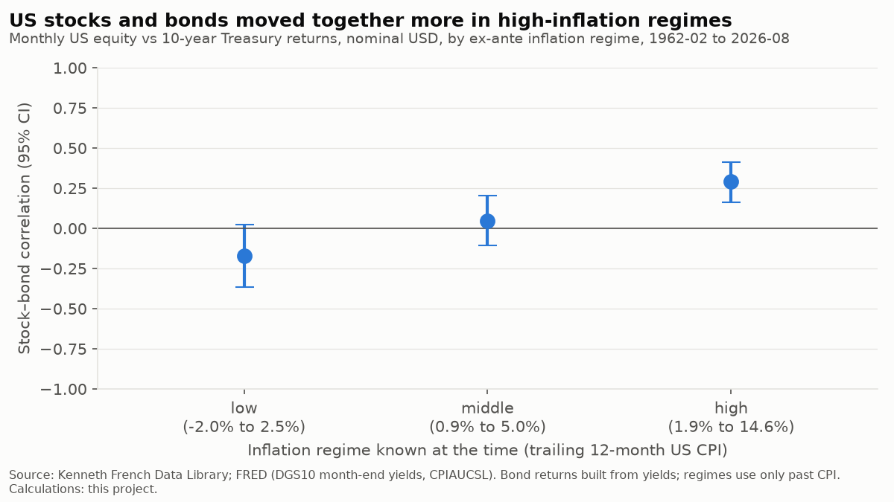

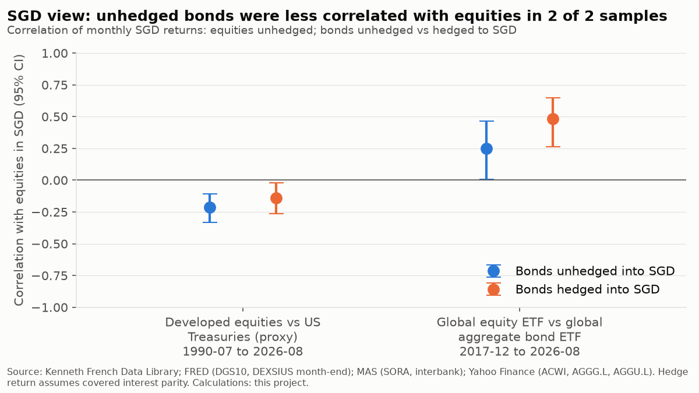

**Caveats**

- CPIAUCSL is today's revised, seasonally adjusted series, not the figures published at the time; the two-month lag covers publication timing but not revisions.
- Safe-haven quantile cut-offs use the full sample, so that test is descriptive. Hedge and safe-haven definitions follow Baur and Lucey (2010, Financial Review 45(2)); the regression form with extreme-quantile interactions is as described in the literature citing them, not checked against the paper's full text.
- Bootstrap block length n^(1/5), the rate Hall, Horowitz and Jing (1995, Biometrika 82(3)) give for two-sided intervals. Regime subsets are not contiguous, so their blocks can span regime changes. The Newey-West lag rule floor(4(n/100)^(2/9)) is attributed to Newey and West (1994); the formula was not checked against the paper's text.
- SGD hedged returns assume covered interest parity with one-month forwards at MAS SGD and US 1-month T-bill rates; real hedges also pay a cross-currency basis and dealing spreads. The long SGD sample uses US Treasuries as a stand-in for global bonds; the like-for-like ETF sample is short (from December 2017).
- Correlation measures co-movement, not size; the portfolio-impact figures show size.
- The JST split at each country's median inflation is in-sample and descriptive.
- Regime inflation ranges overlap because the cut-offs use only past data and move over time: a month at 2% could be 'high' in the low-inflation 1960s and 'low' after the 1970s.

*Source: Jordà-Schularick-Taylor Macrohistory Database (R6, consulted 2026-10-26); Jordà et al. (2019), QJE. Licensed CC BY-NC-SA 4.0. Applies to the JST-derived figures and tables above.*

Table: us by exante inflation regime

|  | inflation_range | months | correlation | ci_low | ci_high | correlation_real | vol_equity | vol_60_40 | vol_reduction | diversification_ratio |
|---|---|---|---|---|---|---|---|---|---|---|
| low | -2.0% to 2.5% | 187 | -0.17 | -0.36 | 0.03 | -0.16 | 14.9% | 8.9% | 40.1% | 1.33 |
| middle | 0.9% to 5.0% | 338 | 0.05 | -0.11 | 0.21 | 0.07 | 14.4% | 9.2% | 36.1% | 1.24 |
| high | 1.9% to 14.6% | 250 | 0.29 | 0.16 | 0.41 | 0.31 | 17.1% | 11.8% | 30.9% | 1.17 |

Table: us non overlapping blocks

| start | end | correlation |
|---|---|---|
| 1962-02 | 1965-01 | 0.15 |
| 1965-02 | 1968-01 | 0.09 |
| 1968-02 | 1971-01 | 0.44 |
| 1971-02 | 1974-01 | 0.10 |
| 1974-02 | 1977-01 | 0.21 |
| 1977-02 | 1980-01 | 0.45 |
| 1980-02 | 1983-01 | 0.35 |
| 1983-02 | 1986-01 | 0.42 |
| 1986-02 | 1989-01 | 0.13 |
| 1989-02 | 1992-01 | 0.54 |
| 1992-02 | 1995-01 | 0.47 |
| 1995-02 | 1998-01 | 0.38 |
| 1998-02 | 2001-01 | -0.02 |
| 2001-02 | 2004-01 | -0.57 |
| 2004-02 | 2007-01 | -0.09 |
| 2007-02 | 2010-01 | -0.14 |
| 2010-02 | 2013-01 | -0.76 |
| 2013-02 | 2016-01 | -0.25 |
| 2016-02 | 2019-01 | -0.24 |
| 2019-02 | 2022-01 | -0.33 |
| 2022-02 | 2025-01 | 0.67 |

Table: us episodes

|  | months | correlation | ci_low | ci_high | chosen |
|---|---|---|---|---|---|
| 1962–1999 | 455 | 0.28 | 0.16 | 0.38 | set in the code before its first run, but informed by published research on a post-2000 sign change, so not independent of the data |
| 2000–2021 | 264 | -0.34 | -0.48 | -0.21 | set in the code before its first run, but informed by published research on a post-2000 sign change, so not independent of the data |
| 1973–1981 | 108 | 0.24 | 0.07 | 0.39 | named in the project spec, after the event |
| 2022 | 12 | 0.60 | 0.25 | 0.88 | named in the project spec, after the event |
| 2022 to latest | 56 | 0.55 | 0.32 | 0.71 | requested with a confidence interval, after the event |
| 2023 to latest (excl. 2022) | 44 | 0.45 | 0.10 | 0.70 | requested, after the event |

Table: us safe haven

|  | slope | p_value |
|---|---|---|
| all months (hedge) | 0.10 | 0.00 |
| bottom 10% equity months (safe haven) | -0.06 | 0.36 |
| bottom 5% equity months (safe haven) | 0.03 | 0.68 |
| bottom 1% equity months (safe haven) | -0.13 | 0.03 |

Table: sgd hedged vs unhedged

| sample | period | bonds | months | correlation | ci_low | ci_high | bond_vol | vol_equity | vol_60_40 | vol_reduction | diversification_ratio |
|---|---|---|---|---|---|---|---|---|---|---|---|
| Developed equities vs US Treasuries (proxy) | 1990-07 to 2026-08 | unhedged | 434 | -0.21 | -0.33 | -0.11 | 8.6% | 13.2% | 8.0% | 39.9% | 1.43 |
| Developed equities vs US Treasuries (proxy) | 1990-07 to 2026-08 | hedged | 434 | -0.14 | -0.27 | -0.02 | 7.3% | 13.2% | 8.1% | 39.0% | 1.35 |
| Global equity ETF vs global aggregate bond ETF | 2017-12 to 2026-08 | unhedged | 105 | 0.25 | 0.01 | 0.46 | 4.4% | 13.0% | 8.4% | 35.4% | 1.14 |
| Global equity ETF vs global aggregate bond ETF | 2017-12 to 2026-08 | hedged | 105 | 0.48 | 0.26 | 0.65 | 4.2% | 13.0% | 8.8% | 32.7% | 1.09 |

Table: jst countries

|  | years | corr_all | corr_high_inflation | corr_low_inflation |
|---|---|---|---|---|
| Germany | 145 | -0.07 | -0.14 | 0.07 |
| Netherlands | 121 | 0.09 | 0.23 | -0.15 |
| Denmark | 147 | 0.17 | 0.27 | -0.24 |
| USA | 149 | 0.19 | 0.30 | -0.07 |
| Sweden | 150 | 0.22 | 0.34 | -0.07 |
| Norway | 140 | 0.24 | 0.27 | 0.05 |
| Australia | 121 | 0.24 | 0.12 | 0.35 |
| Finland | 125 | 0.31 | 0.32 | 0.13 |
| Switzerland | 120 | 0.34 | 0.47 | 0.21 |
| Belgium | 144 | 0.39 | 0.35 | 0.36 |
| Japan | 133 | 0.40 | 0.48 | 0.26 |
| Italy | 150 | 0.43 | 0.42 | 0.34 |
| Portugal | 150 | 0.46 | 0.44 | 0.34 |
| Spain | 117 | 0.46 | 0.45 | 0.38 |
| UK | 150 | 0.47 | 0.51 | 0.36 |
| France | 150 | 0.48 | 0.57 | 0.17 |

## Claim 6: Long-dated bonds earn a reliable term premium over intermediate bonds.

**Verdict: Partially holds.** The 10-year beat the 5-year in 4 of 6 non-overlapping 10-year blocks; the average gap was +0.4% a year (t = 1.0). Over bills, the 10-year earned -2.8% a year while rates rose (1962–1981) and +4.5% while they fell (1981–2020).

**Data.** Monthly, nominal USD. Constant-maturity US Treasury returns built from FRED month-end yields (DGS1, DGS5, DGS10, DGS30), February 1962 onwards (30-year from March 1977); French 1-month T-bill. Long history: JST R6 annual government bond and bill returns, 16 countries.

**Method.** Annualised returns, excess over bills, volatility and Sharpe by maturity. Long minus intermediate: mean monthly difference with a HAC t-test, and the winner in each non-overlapping 10-year block. Ex-ante split by the yield-curve slope known at the start of each month.

**Findings**

- By maturity: 1y (from 1962-02): +0.5% a year over bills, volatility 1.7%, Sharpe 0.41, worst drawdown -2%; 5y (from 1962-02): +1.1% a year over bills, volatility 5.3%, Sharpe 0.23, worst drawdown -15%; 10y (from 1962-02): +1.3% a year over bills, volatility 7.8%, Sharpe 0.21, worst drawdown -26%; 30y (from 1977-03): +2.5% a year over bills, volatility 13.4%, Sharpe 0.25, worst drawdown -49%.
- 10-year minus 5-year by block: 1962-02–1972-01: -0.8%; 1972-02–1982-01: -1.8%; 1982-02–1992-01: +1.6%; 1992-02–2002-01: +1.1%; 2002-02–2012-01: +1.8%; 2012-02–2022-01: +1.0%.
- 30-year minus 5-year (from 1977-03): +1.8% a year (t = 1.3); 30-year won 4 of 4 blocks. 5-year minus bills: +1.2% a year (t = 1.8).
- Ex-ante by yield-curve slope at the start of the month: curve upward-sloping (617 months): 10-year over bills +2.7% a year, over 5-year +1.0%; curve flat or inverted (157 months): 10-year over bills -2.6% a year, over 5-year -2.0%.
- Rate eras (chosen after seeing the data, at the 1981 yield peak and 2020 trough): Rising rates 1962–1981: 10-year -2.8% a year over bills, -1.3% over 5-year; Falling rates 1981–2020: 10-year +4.5% a year over bills, +1.6% over 5-year; 2021 to latest: 10-year -5.5% a year over bills, -2.1% over 5-year.
- Long history: government bonds beat bills in 16 of 16 JST countries (annual, nominal).

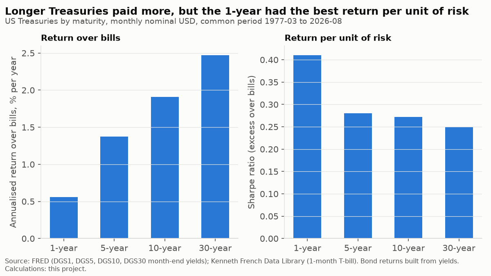

**Caveats**

- Returns are built from constant-maturity yields, not traded bonds; they ignore transaction costs and the roll-down of real bond portfolios.
- 1981–2020 was a 40-year fall in yields that flattered long bonds; the full-sample averages mix that era with the rising-rate one.
- Few independent blocks: 64 years give six 10-year blocks for 10y vs 5y and four for 30y vs 5y.
- Nominal USD; for an SGD investor, hedged returns add the SGD-USD rate difference (claim 12).

*Source: Jordà-Schularick-Taylor Macrohistory Database (R6, consulted 2026-10-26); Jordà et al. (2019), QJE. Licensed CC BY-NC-SA 4.0. Applies to the JST-derived figures and tables above.*

Table: us by maturity

|  | start | annual_return | excess_over_bills | volatility | sharpe | max_drawdown |
|---|---|---|---|---|---|---|
| bills | 1962-02 | 4.4% | 0.0% | 0.9% | n/a | 0.0% |
| 1y | 1962-02 | 5.0% | 0.5% | 1.7% | 0.41 | -2.3% |
| 5y | 1962-02 | 5.5% | 1.1% | 5.3% | 0.23 | -14.6% |
| 10y | 1962-02 | 5.8% | 1.3% | 7.8% | 0.21 | -26.1% |
| 30y | 1977-03 | 6.8% | 2.5% | 13.4% | 0.25 | -49.3% |

Table: us by maturity common period

|  | start | annual_return | excess_over_bills | volatility | sharpe | max_drawdown |
|---|---|---|---|---|---|---|
| bills | 1977-03 | 4.2% | 0.0% | 1.0% | n/a | 0.0% |
| 1y | 1977-03 | 4.8% | 0.6% | 1.8% | 0.41 | -2.3% |
| 5y | 1977-03 | 5.7% | 1.4% | 5.5% | 0.28 | -14.6% |
| 10y | 1977-03 | 6.2% | 1.9% | 8.3% | 0.27 | -26.1% |
| 30y | 1977-03 | 6.8% | 2.5% | 13.4% | 0.25 | -49.3% |

Table: long vs intermediate

|  | start | mean_diff_annualised | t_stat | p_value | blocks | blocks_long_won |
|---|---|---|---|---|---|---|
| 10y vs 5y | 1962-02 | 0.4% | 0.97 | 0.33 | 6 | 4 |
| 30y vs 5y | 1977-03 | 1.8% | 1.34 | 0.18 | 4 | 4 |
| 5y vs bills | 1962-02 | 1.2% | 1.81 | 0.07 | 6 | 5 |

Table: us by curve slope

|  | months | 10y_minus_bills_annualised | 10y_minus_5y_annualised |
|---|---|---|---|
| curve upward-sloping | 617 | 2.7% | 1.0% |
| curve flat or inverted | 157 | -2.6% | -2.0% |

Table: us rate eras

|  | 10y_excess_over_bills | 10y_minus_5y_annualised | yield_start |
|---|---|---|---|
| Rising rates 1962–1981 | -2.8% | -1.3% | 4.0% |
| Falling rates 1981–2020 | 4.5% | 1.6% | 14.6% |
| 2021 to latest | -5.5% | -2.1% | 1.1% |

Table: jst bonds vs bills

|  | years | bond_minus_bill_annualised |
|---|---|---|
| Denmark | 145 | 0.2% |
| USA | 150 | 0.4% |
| Australia | 118 | 0.7% |
| UK | 151 | 0.8% |
| Netherlands | 151 | 1.2% |
| Sweden | 150 | 1.2% |
| Norway | 151 | 1.2% |
| Italy | 131 | 1.3% |
| Switzerland | 120 | 1.3% |
| Spain | 115 | 1.4% |
| France | 144 | 1.4% |
| Portugal | 141 | 1.6% |
| Germany | 144 | 1.6% |
| Belgium | 145 | 1.7% |
| Japan | 140 | 1.7% |
| Finland | 151 | 2.2% |

## Claim 7: Corporate bonds earn a credit premium, and carry some equity-like risk.

**Verdict: Holds.** Investment-grade credit beat Treasuries by +2.0% a year on the long yield-built series (no defaults, an upper bound) and by +1.0% realised since 2002 (t = 1.0). Its equity beta was 0.25 monthly, and its return relative to Treasuries was -18% from January 2008 to March 2009.

**Data.** Long history: Aswath Damodaran annual Baa corporate and 10-year Treasury returns, both built from yields, 1928 onwards, nominal USD. Realised: Yahoo Finance monthly total returns of LQD and IEF, nominal USD. Equity: Damodaran S&P 500 (annual) and French US market (monthly), over bills.

**Method.** Credit excess return over duration-similar Treasuries; annualised geometric return, HAC t-test on the mean. Equity link: regression of credit excess on equity excess (HAC errors), correlation, and credit excess in the worst 10% of equity periods.

**Findings**

- Long history 1928–2025 (annual, yield-built): +2.0% a year (t = 4.8), volatility 6.3%, worst drawdown -23%; Realised 2002-08 to 2026-09 (monthly, LQD vs IEF): +1.0% a year (t = 1.0), volatility 5.8%, worst drawdown -25%.
- Equity-like risk: Long history (annual): beta 0.16 (t = 4.2), correlation 0.48, equities explain 23% of the variance; average credit excess -4.5% in the worst 10% of equity periods vs +3.0% otherwise; Realised (monthly): beta 0.25 (t = 9.1), correlation 0.64, equities explain 40% of the variance; average credit excess -2.2% in the worst 10% of equity periods vs +0.4% otherwise.

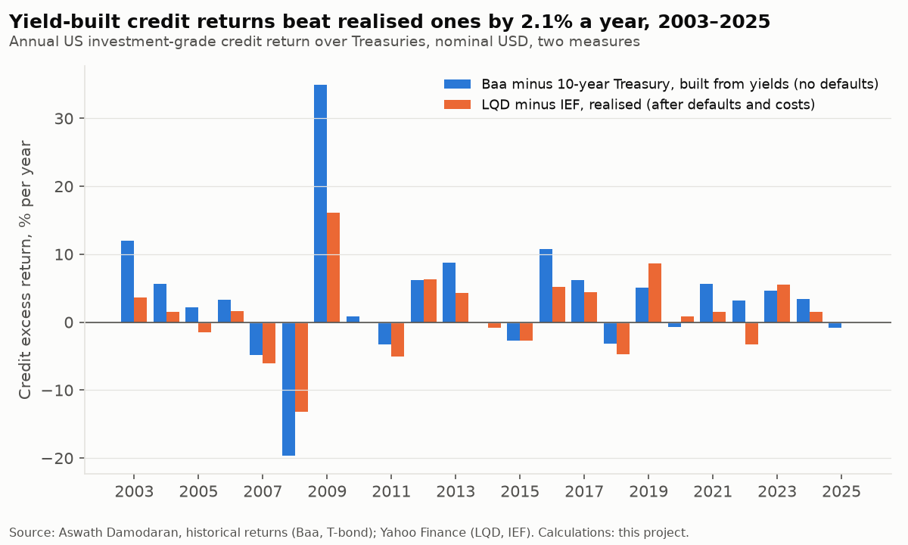

**Caveats**

- The long series is built from Moody's Baa yields with no default losses, so its premium is an upper bound. The realised series is short (since 2002) and covers one major credit crisis.
- LQD and IEF durations are similar but not identical, so part of the realised excess return is a duration effect; fund fees are included in both.
- Investment grade only; high yield is outside the asset universe in the brief.
- Nominal USD before tax.

Table: credit excess

|  | annualised_excess | volatility | mean_t_stat | worst_drawdown |
|---|---|---|---|---|
| Long history 1928–2025 (annual, yield-built) | 2.0% | 6.3% | 4.84 | -23.5% |
| Realised 2002-08 to 2026-09 (monthly, LQD vs IEF) | 1.0% | 5.8% | 1.04 | -25.0% |

Table: equity link

|  | beta_to_equity | beta_t | correlation | r_squared | credit_in_worst_10pct_equity | credit_other_periods |
|---|---|---|---|---|---|---|
| Long history (annual) | 0.16 | 4.18 | 0.48 | 22.9% | -4.5% | 3.0% |
| Realised (monthly) | 0.25 | 9.15 | 0.64 | 40.4% | -2.2% | 0.4% |

## Claim 8: Inflation-linked bonds hedge inflation.

**Verdict: Partially holds.** Over one-year horizons, 10-year TIPS kept pace with inflation in 14 of 22 calendar years (13 for nominal 10-year Treasuries). In 2022 they returned -16.9% against 6.5% inflation: the accrual added +7.7% but rising real yields took -23.0%.

**Data.** Monthly, nominal USD. 10-year constant-maturity TIPS built from FRED month-end real yields (DFII10) and CPI-U NSA (CPIAUCNS), 2003-02 to 2026-09. Check: TIP ETF (Yahoo). Comparison: 10-year nominal Treasury built from DGS10.

**Method.** Monthly TIPS return split into inflation accrual (CPI with the TIPS reference lag), real carry and real-yield change. Hedge test on complete calendar years: real return after Dec/Dec CPI-U inflation. Inflation beta from annual returns.

**Findings**

- Monthly variance: the real-yield effect alone is 101% of total TIPS return variance, the inflation accrual 4%. Over short horizons TIPS returns are driven mainly by real-yield moves.
- Inflation beta (annual return on annual inflation, 95% CI): TIPS (built): -0.71 [-2.85, 1.43]; 10-year nominal Treasury: -2.53 [-4.59, -0.46]. A perfect one-year hedge would have a beta of 1.
- In the 11 years with above-median inflation, TIPS kept pace in 6 and nominal Treasuries in 5.
- 2022 decomposition: accrual +7.7%, real carry +0.3%, real-yield change -23.0%; TIPS -16.9% vs nominal 10-year -16.4%.
- Check against the TIP ETF (2004–2025): correlation of annual returns 0.99, average gap -0.0% a year (the ETF holds shorter maturities and pays a fee).
- Held to maturity, a TIPS locks in its real yield at purchase plus realised inflation (before the CPI lag and tax); that horizon is not tested here because the data cover fewer than three non-overlapping 10-year periods.

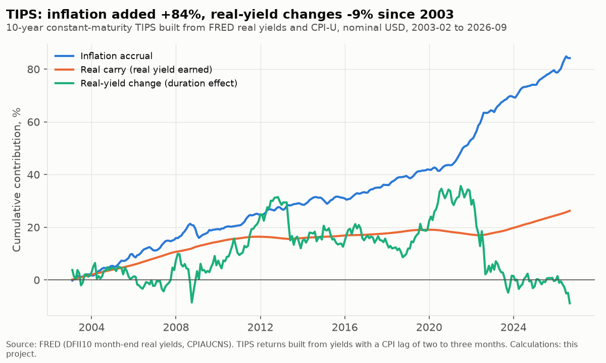

**Caveats**

- TIPS returns are built from constant-maturity real yields, not traded bonds; the real-yield series starts in 2003 and includes the low-liquidity 2008 episode.
- US CPI-U inflation and USD returns: an SGD investor's inflation is Singapore CPI, and there are no SGD inflation-linked government bonds to compare.
- The above-median-inflation split is in-sample and descriptive.
- Taxes on the inflation accrual are ignored.
- Variance shares can exceed 100% in total, because the accrual and the real-yield effect partly offset each other.
- October 2025 US CPI was not published. For TIPS, Treasury's announced index number for that month (325.604, 26 November 2025) is used, as the bonds themselves do (reference/cpi_contingency.csv).

Table: annual

| month | tips | nominal_10y | accrual | real_carry | real_yield_effect | inflation | tips_real | nominal_real |
|---|---|---|---|---|---|---|---|---|
| 2004 | 8.1% | 4.5% | 3.2% | 1.9% | 2.8% | 3.3% | 4.6% | 1.2% |
| 2005 | 2.6% | 3.0% | 4.3% | 1.8% | -3.4% | 3.4% | -0.8% | -0.4% |
| 2006 | 0.4% | 2.2% | 1.3% | 2.3% | -3.1% | 2.5% | -2.1% | -0.3% |
| 2007 | 12.4% | 10.4% | 3.5% | 2.3% | 6.2% | 4.1% | 8.0% | 6.1% |
| 2008 | 1.3% | 20.4% | 3.7% | 1.8% | -4.0% | 0.1% | 1.2% | 20.3% |
| 2009 | 7.5% | -10.1% | -0.2% | 1.7% | 5.9% | 2.7% | 4.7% | -12.5% |
| 2010 | 6.9% | 7.9% | 1.2% | 1.1% | 4.5% | 1.5% | 5.3% | 6.3% |
| 2011 | 15.4% | 16.1% | 3.5% | 0.6% | 10.9% | 3.0% | 12.1% | 12.8% |
| 2012 | 8.0% | 2.7% | 2.2% | -0.5% | 6.2% | 1.7% | 6.1% | 1.0% |
| 2013 | -12.9% | -8.5% | 1.0% | -0.0% | -13.7% | 1.5% | -14.2% | -9.8% |
| 2014 | 5.1% | 10.6% | 1.7% | 0.4% | 3.0% | 0.8% | 4.3% | 9.7% |
| 2015 | -1.8% | 1.1% | 0.2% | 0.4% | -2.4% | 0.7% | -2.5% | 0.4% |
| 2016 | 4.1% | 0.1% | 1.6% | 0.2% | 2.2% | 2.1% | 2.0% | -1.9% |
| 2017 | 3.1% | 2.8% | 2.0% | 0.5% | 0.6% | 2.1% | 0.9% | 0.7% |
| 2018 | -1.9% | 0.3% | 2.5% | 0.8% | -5.1% | 1.9% | -3.7% | -1.6% |
| 2019 | 10.6% | 9.2% | 1.8% | 0.4% | 8.3% | 2.3% | 8.2% | 6.8% |
| 2020 | 13.7% | 10.4% | 1.2% | -0.6% | 13.0% | 1.4% | 12.1% | 8.9% |
| 2021 | 5.0% | -4.1% | 6.2% | -0.9% | -0.3% | 7.0% | -1.9% | -10.4% |
| 2022 | -16.9% | -16.4% | 7.7% | 0.3% | -23.0% | 6.5% | -21.9% | -21.4% |
| 2023 | 3.5% | 3.8% | 3.2% | 1.7% | -1.4% | 3.4% | 0.1% | 0.5% |
| 2024 | -0.3% | -1.5% | 2.6% | 1.9% | -4.6% | 2.9% | -3.1% | -4.3% |
| 2025 | 8.1% | 7.7% | 3.1% | 2.0% | 2.8% | 2.7% | 5.3% | 4.9% |

Table: inflation beta

|  | beta | ci_low | ci_high |
|---|---|---|---|
| TIPS (built) | -0.71 | -2.85 | 1.43 |
| 10-year nominal Treasury | -2.53 | -4.59 | -0.46 |

Table: check vs tip etf

| month | tips | tip_etf |
|---|---|---|
| 2004 | 8.1% | 8.3% |
| 2005 | 2.6% | 2.5% |
| 2006 | 0.4% | 0.3% |
| 2007 | 12.4% | 11.9% |
| 2008 | 1.3% | 0.0% |
| 2009 | 7.5% | 8.9% |
| 2010 | 6.9% | 6.1% |
| 2011 | 15.4% | 13.3% |
| 2012 | 8.0% | 6.4% |
| 2013 | -12.9% | -8.5% |
| 2014 | 5.1% | 3.6% |
| 2015 | -1.8% | -1.8% |
| 2016 | 4.1% | 4.7% |
| 2017 | 3.1% | 2.9% |
| 2018 | -1.9% | -1.4% |
| 2019 | 10.6% | 8.3% |
| 2020 | 13.7% | 10.8% |
| 2021 | 5.0% | 5.7% |
| 2022 | -16.9% | -12.2% |
| 2023 | 3.5% | 3.8% |
| 2024 | -0.3% | 1.7% |
| 2025 | 8.1% | 6.8% |

## Claim 9: Real estate earns long-run returns comparable to equities (listed REITs tested; housing reported separately).

**Verdict: Fails.** Listed REIT ETFs matched or beat equities over the same months in 0 of 8 cases; US REITs (VNQ, 2004-10 to 2026-08) returned 7.5% a year vs 11.4% for US equities, with a worst drawdown of -68%. Adding 10% REITs to a 60/40 portfolio changed its Sharpe ratio from 0.72 to 0.68; spanning alpha -3.7% a year (t = -1.2).

**Data.** Listed REITs: Yahoo Finance monthly total returns (close + distributions) of VNQ, VNQI, RWO, REET, IDWP.L, CLR.SI, CFA.SI, SRT.SI; equities: French US market, ACWI (Yahoo), FRED month-end USD/SGD for SGD benchmarks. Housing: JST R6 annual total and capital-gain returns, 1870–2020. Nominal returns in each ETF's trading currency; housing real, local currency.

**Method.** Each REIT ETF compared with an equity benchmark on the same months (annualised total return, volatility, drawdown, correlation). Spanning regression of VNQ excess returns on US equity and 10-year Treasury excess returns (HAC); Sharpe of 60/40 vs 54/36/10 with REITs, rebalanced monthly. Housing: real CAGR of total return vs price-only vs equities per country.

**Findings**

- REIT ETFs vs equities: VNQ (2004-10 to 2026-08): 7.5% vs 11.4% US market, volatility 21.4% vs 15.2%, correlation 0.73; VNQI (2010-12 to 2026-09): 3.3% vs 10.7% ACWI, volatility 16.4% vs 14.1%, correlation 0.82; RWO (2008-06 to 2026-09): 3.6% vs 8.1% ACWI, volatility 20.2% vs 16.5%, correlation 0.85; REET (2014-08 to 2026-09): 4.1% vs 10.5% ACWI, volatility 16.7% vs 14.2%, correlation 0.79; IDWP.L (2008-04 to 2026-09): 2.3% vs 8.5% ACWI, volatility 19.7% vs 16.6%, correlation 0.83; CLR.SI (2017-11 to 2026-09): 1.6% vs 10.8% ACWI in SGD, volatility 13.7% vs 12.9%, correlation 0.58; CFA.SI (2017-04 to 2026-09): 1.8% vs 11.2% ACWI in SGD, volatility 12.7% vs 12.5%, correlation 0.56; SRT.SI (2021-12 to 2026-09): -1.7% vs 9.8% ACWI in SGD, volatility 13.7% vs 12.3%, correlation 0.41.
- US REIT correlations (VNQ): full period: 0.73 with equities, 0.10 with Treasuries; 2008–2009: 0.85 with equities, -0.09 with Treasuries; 2020: 0.94 with equities, -0.50 with Treasuries; 2022: 0.90 with equities, 0.55 with Treasuries. Rolling 36-month correlation with equities ranged from 0.16 to 0.90.
- Spanning test: VNQ's alpha over US equities and Treasuries was -3.7% a year (t = -1.2), equity beta 1.06, bond beta 0.55. REITs did not add a statistically significant return at equal risk beyond equities and bonds; a correlation below 1 alone is not evidence that they do.
- Housing (JST, real, rent included) returned at least as much as equities in 14 of 16 countries. Price-only house indices understated the real total return by a median 5.0% a year across countries (the net rental yield), so comparing them with total-return equities is misleading.
- Sanity checks: VNQ: 264 months, 0 missing, total 7.2% vs price-only 2.7% a year, 2008–2009 drawdown -62%; VNQI: 190 months, 0 missing, total 3.3% vs price-only -0.7% a year; RWO: 220 months, 0 missing, total 3.6% vs price-only -0.4% a year; REET: 146 months, 0 missing, total 4.1% vs price-only 0.2% a year; IDWP.L: 224 months, 0 missing, total 2.6% vs price-only 0.4% a year; CLR.SI: 107 months, 0 missing, total 1.6% vs price-only -3.2% a year; CFA.SI: 114 months, 0 missing, total 1.8% vs price-only -3.1% a year; SRT.SI: 58 months, 0 missing, total -1.7% vs price-only -6.8% a year. VNQ was also compared privately with Nareit's All Equity REITs series; the result is not reported because Nareit's terms do not permit it.

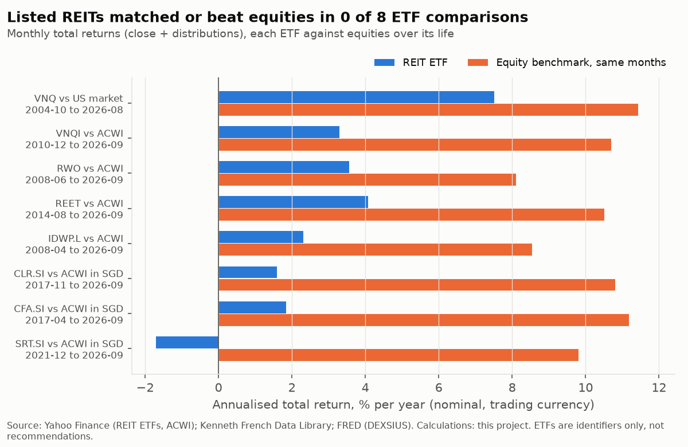

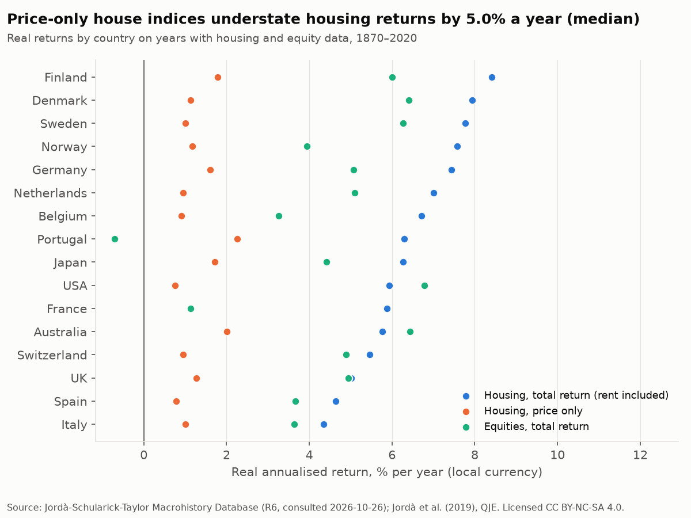

**Caveats**

- Listed REIT history here starts in 2004 (US) and 2008 (global); one full credit cycle. No free, long, verifiable non-US REIT total-return series was found, so nothing is spliced or extrapolated (see docs/limitations.md).
- ETF returns are market-price based and after fund fees; issuer cross-checks (at least 3 years per ETF) are pending in reference/etf_annual_returns.csv.
- Withholding tax on REIT distributions for a Singapore resident is not deducted here; it is calculated by fund domicile in Phase 4 and can be material given REIT yields.
- Housing returns (JST) are estimates for an unlevered, illiquid, undiversified asset and are not comparable to investable index returns.

*Source: Jordà-Schularick-Taylor Macrohistory Database (R6, consulted 2026-10-26); Jordà et al. (2019), QJE. Licensed CC BY-NC-SA 4.0. Applies to the JST-derived figures and tables above.*

Table: reit etfs vs equities

|  | description | benchmark | period | reit_return | benchmark_return | reit_vol | benchmark_vol | reit_max_drawdown | correlation |
|---|---|---|---|---|---|---|---|---|---|
| VNQ | US REITs, from 2004 | US market | 2004-10 to 2026-08 | 7.5% | 11.4% | 21.4% | 15.2% | -68.3% | 0.73 |
| VNQI | developed and emerging ex-US real estate, from 2010 | ACWI | 2010-12 to 2026-09 | 3.3% | 10.7% | 16.4% | 14.1% | -32.8% | 0.82 |
| RWO | global REITs, from 2008 | ACWI | 2008-06 to 2026-09 | 3.6% | 8.1% | 20.2% | 16.5% | -57.7% | 0.85 |
| REET | global REITs, from 2014 | ACWI | 2014-08 to 2026-09 | 4.1% | 10.5% | 16.7% | 14.2% | -30.8% | 0.79 |
| IDWP.L | UCITS developed-markets property yield, USD line, from 2008 | ACWI | 2008-04 to 2026-09 | 2.3% | 8.5% | 19.7% | 16.6% | -63.9% | 0.83 |
| CLR.SI | Singapore REITs, from 2017 | ACWI in SGD | 2017-11 to 2026-09 | 1.6% | 10.8% | 13.7% | 12.9% | -22.3% | 0.58 |
| CFA.SI | Asia ex-Japan REITs, from 2017 | ACWI in SGD | 2017-04 to 2026-09 | 1.8% | 11.2% | 12.7% | 12.5% | -28.2% | 0.56 |
| SRT.SI | Singapore REITs, from 2021 | ACWI in SGD | 2021-12 to 2026-09 | -1.7% | 9.8% | 13.7% | 12.3% | -21.2% | 0.41 |

Table: us reit correlations

|  | with US equities | with 10-year Treasuries |
|---|---|---|
| full period | 73.0% | 10.0% |
| 2008–2009 | 84.7% | -8.8% |
| 2020 | 93.5% | -49.9% |
| 2022 | 89.6% | 54.5% |

Table: reit sanity checks

|  | months | missing_months | total_return | price_only_return | drawdown_2008_2009 |
|---|---|---|---|---|---|
| VNQ | 264 | 0.0% | 7.2% | 2.7% | -62.1% |
| VNQI | 190 | 0.0% | 3.3% | -0.7% | n/a |
| RWO | 220 | 0.0% | 3.6% | -0.4% | n/a |
| REET | 146 | 0.0% | 4.1% | 0.2% | n/a |
| IDWP.L | 224 | 0.0% | 2.6% | 0.4% | n/a |
| CLR.SI | 107 | 0.0% | 1.6% | -3.2% | n/a |
| CFA.SI | 114 | 0.0% | 1.8% | -3.1% | n/a |
| SRT.SI | 58 | 0.0% | -1.7% | -6.8% | n/a |

Table: housing by country

|  | years | housing_total | housing_price_only | equity |
|---|---|---|---|---|
| Italy | 86 | 4.3% | 1.0% | 3.6% |
| Spain | 120 | 4.6% | 0.8% | 3.7% |
| UK | 118 | 5.0% | 1.3% | 4.9% |
| Switzerland | 119 | 5.5% | 0.9% | 4.9% |
| Australia | 120 | 5.8% | 2.0% | 6.4% |
| France | 150 | 5.9% | 1.1% | 1.1% |
| USA | 130 | 5.9% | 0.8% | 6.8% |
| Japan | 75 | 6.3% | 1.7% | 4.4% |
| Portugal | 73 | 6.3% | 2.3% | -0.7% |
| Belgium | 120 | 6.7% | 0.9% | 3.3% |
| Netherlands | 121 | 7.0% | 1.0% | 5.1% |
| Germany | 116 | 7.4% | 1.6% | 5.1% |
| Norway | 140 | 7.6% | 1.2% | 3.9% |
| Sweden | 138 | 7.8% | 1.0% | 6.3% |
| Denmark | 145 | 7.9% | 1.1% | 6.4% |
| Finland | 99 | 8.4% | 1.8% | 6.0% |

## Claim 10: Missing the best days destroys returns.

**Verdict: Holds.** Missing the best 20 of 26,317 days changed the annual return from 10.3% to 8.3%. Missing the worst 20 gave 12.4%, and missing both 10.4%. Best days sat a median 7 trading days from a worst day, against 359 for random days (p < 0.0005).

**Data.** Kenneth French Data Library, daily US market total return and 1-month T-bill, 1926-07-01 to 2026-08-31, nominal USD.

**Method.** Annualised return over the full period with the selected days replaced by that day's T-bill return. Clustering: median distance from the 100 best to the nearest of the 100 worst days, against 2,000 random draws of 100 days; and the share of extreme days in high-volatility periods known at the time.

**Findings**

- Fully invested: 10.3%; Miss best 10: 9.2%; Miss best 20: 8.3%; Miss best 50: 6.4%; Miss best 100: 4.0%; Miss worst 10: 11.5%; Miss worst 20: 12.4%; Miss worst 50: 14.6%; Miss worst 100: 17.4%; Miss best and worst 10: 10.4%; Miss best and worst 20: 10.4%; Miss best and worst 50: 10.5%; Miss best and worst 100: 10.7%.
- High volatility known the day before (top 10% of trailing 21-day volatility, expanding window) covered 8% of days but 66% of the 100 best days and 52% of the 100 worst days.
- Best and worst days cluster in the same turbulent periods (permutation p < 0.0005), so a strategy that avoided the worst days would likely have missed many of the best ones too; missing only the best days is not a realistic scenario.

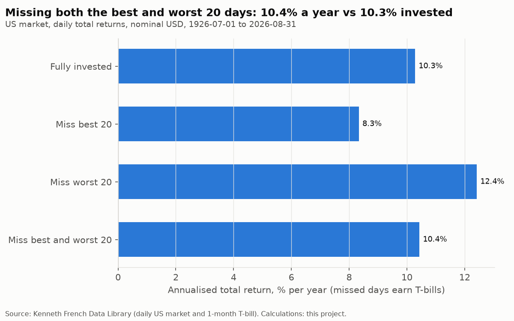

**Caveats**

- Choosing which days to miss uses hindsight; the scenarios are illustrations, not strategies anyone could have followed.
- US market only, before costs and taxes. The 1930s and 1987 dominate the extreme days.
- The permutation test treats the 100 worst days as fixed and draws best days at random, which ignores volatility clustering in the null; it tests proximity, not cause.

Table: scenarios

|  | annualised_return |
|---|---|
| Fully invested | 10.3% |
| Miss best 10 | 9.2% |
| Miss best 20 | 8.3% |
| Miss best 50 | 6.4% |
| Miss best 100 | 4.0% |
| Miss worst 10 | 11.5% |
| Miss worst 20 | 12.4% |
| Miss worst 50 | 14.6% |
| Miss worst 100 | 17.4% |
| Miss best and worst 10 | 10.4% |
| Miss best and worst 20 | 10.4% |
| Miss best and worst 50 | 10.5% |
| Miss best and worst 100 | 10.7% |

Table: clustering

|  | value |
|---|---|
| median_days_best_to_worst | 7 |
| random_median_days | 359 |
| p_value | 0.0% |
| best_in_high_vol | 66.0% |
| worst_in_high_vol | 52.0% |
| high_vol_share_overall | 8.3% |

## Claim 11: Rebalancing reduces volatility and drawdown.

**Verdict: Holds.** 5 of 5 rebalancing rules had lower volatility and a smaller maximum drawdown than buy-and-hold (12.5% volatility, -41% drawdown, equity drifting up to 97%). Annual rebalancing: 10.0% and -29%. The best rule by Sharpe (Annual) was distinguishable from the worst (Monthly) after costs: 95% interval for the difference +0.01 to +0.05; before costs, -0.01 to +0.03.

**Data.** Monthly, nominal USD. French US market total return; 10-year constant-maturity Treasury built from FRED month-end yields; French 1-month T-bill. 1962-02 to 2026-08.

**Method.** Simulated 60/40 portfolios with weights drifting between rebalances (analysis.portfolio). Costs per leg at the USD 25,000 minimum allocation: half the published bid-ask spread (ACWI, IEF) plus broker and regulatory fees. Sharpe over T-bills. Best-versus-worst Sharpe difference by moving-block bootstrap.

**Findings**

- Buy and hold: return 9.89%, volatility 12.5%, Sharpe 0.47, max drawdown -41%, turnover 0.0% a year, costs 0.000% a year; Monthly: return 8.86%, volatility 10.1%, Sharpe 0.47, max drawdown -30%, turnover 10.3% a year, costs 0.194% a year; Quarterly: return 9.12%, volatility 10.0%, Sharpe 0.49, max drawdown -30%, turnover 6.7% a year, costs 0.065% a year; Annual: return 9.15%, volatility 10.0%, Sharpe 0.50, max drawdown -29%, turnover 3.6% a year, costs 0.016% a year; Band ±5 pts: return 9.17%, volatility 10.1%, Sharpe 0.49, max drawdown -30%, turnover 3.5% a year, costs 0.010% a year; Band ±10 pts: return 9.24%, volatility 10.3%, Sharpe 0.49, max drawdown -29%, turnover 2.0% a year, costs 0.003% a year.
- Costs at USD 25,000: monthly rebalancing 0.194% a year, annual 0.016% a year.
- Buy-and-hold's equity weight drifted up to 97%, so the comparison is partly between different average risk levels, not only between rebalancing methods.
- Data-mining check: after costs, Sharpe ratios across the five rules ranged from 0.47 to 0.50; before costs, from 0.49 to 0.50. Where the best-versus-worst interval excludes zero only after costs, the difference comes from trading costs (minimum fees per order), not from the rebalancing rule itself. Picking one rule from several after seeing results would otherwise be fitting noise.

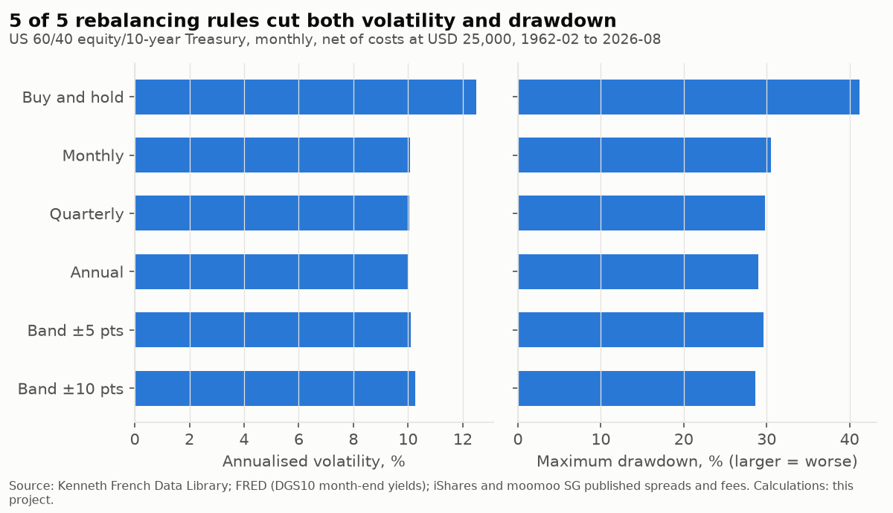

**Caveats**

- Spreads and fees are today's; historical costs were higher, which matters most for monthly rebalancing. Per-share fees use current ETF prices as stand-ins.
- Taxes are ignored (Singapore has no capital gains tax for individuals, but withholding tax on distributions applies; see Phase 3).
- The US Treasury leg is built from yields, not traded; one 64-year sample with one long fall in rates.

Table: rules after costs

|  | annual_return | volatility | sharpe | max_drawdown | equity_weight_max | rebalances_per_year | turnover_per_year | cost_per_year |
|---|---|---|---|---|---|---|---|---|
| Buy and hold | 9.9% | 12.5% | 0.47 | -41.2% | 96.6% | 0.0% | 0.0% | 0.0% |
| Monthly | 8.9% | 10.1% | 0.47 | -30.5% | 63.2% | 12 | 10.3% | 0.2% |
| Quarterly | 9.1% | 10.0% | 0.49 | -29.8% | 65.7% | 4.0 | 6.7% | 0.1% |
| Annual | 9.2% | 10.0% | 0.50 | -29.0% | 68.9% | 99.1% | 3.6% | 0.0% |
| Band ±5 pts | 9.2% | 10.1% | 0.49 | -29.6% | 66.5% | 60.4% | 3.5% | 0.0% |
| Band ±10 pts | 9.2% | 10.3% | 0.49 | -28.7% | 70.6% | 18.6% | 2.0% | 0.0% |

Table: rules before costs

|  | annual_return | volatility | sharpe | max_drawdown | equity_weight_max | rebalances_per_year | turnover_per_year | cost_per_year |
|---|---|---|---|---|---|---|---|---|
| Buy and hold | 9.9% | 12.5% | 0.47 | -41.2% | 96.6% | 0.0% | 0.0% | 0.0% |
| Monthly | 9.1% | 10.1% | 0.49 | -30.3% | 63.2% | 12 | 10.3% | 0.0% |
| Quarterly | 9.2% | 10.0% | 0.50 | -29.8% | 65.7% | 4.0 | 6.7% | 0.0% |
| Annual | 9.2% | 10.0% | 0.50 | -29.0% | 68.9% | 99.1% | 3.6% | 0.0% |
| Band ±5 pts | 9.2% | 10.1% | 0.50 | -29.6% | 66.5% | 60.4% | 3.5% | 0.0% |
| Band ±10 pts | 9.2% | 10.3% | 0.49 | -28.7% | 70.6% | 18.6% | 2.0% | 0.0% |

## Claim 12: Long-run real returns are similar hedged and unhedged (SGD investor; equities and bonds analysed separately).

**Verdict: Holds.** Hedged and unhedged returns were not significantly different in 4 of 4 samples. Hedging lowered bond volatility (hedged/unhedged ratio 0.91 on average) and raised equity volatility (1.10).

**Data.** Monthly. USD assets: French US and developed-market equity total returns; US 10-year Treasury built from FRED month-end yields; AGGG.L (unhedged) and AGGU.L (USD-hedged) global aggregate bond ETF classes from Yahoo. FX: FRED DEXSIUS month-end. Rates: MAS SGD (SORA-based) and French 1-month T-bill. Inflation: SingStat CPI. Returns in SGD, real.

**Method.** Unhedged: USD return compounded with the USD/SGD change. Hedged: USD return plus the SGD-minus-USD one-month rate (covered interest parity). Mean monthly difference tested with a HAC t-statistic; volatility compared as a ratio.

**Findings**

- US equities (1987-07 to 2026-08): real +7.5% unhedged vs +7.5% hedged a year (difference +0.2%, t = 0.2); volatility 14.7% vs 15.5%; Developed-market equities (1990-07 to 2026-08): real +5.5% unhedged vs +5.4% hedged a year (difference +0.1%, t = 0.1); volatility 13.2% vs 15.0%; US 10-year Treasuries (1987-07 to 2026-08): real +1.9% unhedged vs +2.0% hedged a year (difference -0.0%, t = -0.1); volatility 8.6% vs 7.3%; Global aggregate bonds (ETF classes) (2017-12 to 2026-08): real -2.5% unhedged vs -1.4% hedged a year (difference +1.2%, t = 1.6); volatility 4.4% vs 4.2%.
- For equities, the unhedged USD exposure lowered volatility in SGD: the monthly USD/SGD change correlated -0.32 with US equity returns in USD, so the USD tended to rise against the SGD when equities fell, and hedging removed that offset.
- The hedged-minus-unhedged difference has two parts: the rate carry (SGD minus USD one-month rates) and the USD/SGD move. US equities: carry -1.3% a year, USD vs SGD -1.3% a year; Global aggregate bonds (ETF classes): carry -0.9% a year, USD vs SGD -0.7% a year.

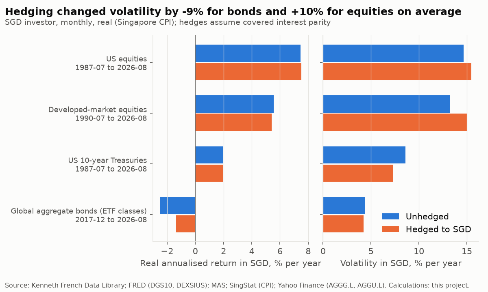

**Caveats**

- Hedged returns assume covered interest parity with monthly forwards at MAS SGD and US T-bill rates; real forward hedges also pay a cross-currency basis and dealing spreads, and SGD-hedged share classes charge a fee.
- The SGD appreciated against the USD over much of the sample; one currency path, about 39 years at most, is a small sample for currency effects.
- US assets stand in for global ones in the long samples; the like-for-like global bond comparison starts in December 2017.
- Before costs and withholding tax.

Table: samples

|  | asset_class | period | real_return_unhedged | real_return_hedged | difference_per_year | difference_t | hedge_carry_per_year | usd_vs_sgd_per_year | vol_unhedged | vol_hedged | vol_ratio_hedged_to_unhedged | max_drawdown_unhedged | max_drawdown_hedged |
|---|---|---|---|---|---|---|---|---|---|---|---|---|---|
| US equities | equities | 1987-07 to 2026-08 | 7.5% | 7.5% | 0.2% | 0.21 | -1.3% | -1.3% | 14.7% | 15.5% | 1.06 | -53.4% | -54.9% |
| Developed-market equities | equities | 1990-07 to 2026-08 | 5.5% | 5.4% | 0.1% | 0.14 | -1.2% | -1.0% | 13.2% | 15.0% | 1.13 | -54.6% | -56.5% |
| US 10-year Treasuries | bonds | 1987-07 to 2026-08 | 1.9% | 2.0% | -0.0% | -0.05 | -1.3% | -1.3% | 8.6% | 7.3% | 0.85 | -37.6% | -36.8% |
| Global aggregate bonds (ETF classes) | bonds | 2017-12 to 2026-08 | -2.5% | -1.4% | 1.2% | 1.56 | -0.9% | -0.7% | 4.4% | 4.2% | 0.97 | -32.0% | -25.2% |

## Claim 13: Investors underperform the funds they invest in.

**Verdict: Not testable with our data.** Fund-flow data are needed and not available here. Our data do show that a gap between investor (dollar-weighted) and fund (time-weighted) returns appears without any behaviour: for steady monthly saving over 80 rolling 20-year windows, it ranged from -3.1% to +5.2% a year (median +0.1%).

**Data.** Kenneth French Data Library, US market total return, monthly, nominal USD. Literature: publisher listings and summaries cited below.

**Method.** Dollar-weighted return: annualised internal rate of return of equal start-of-month contributions valued at the end of each 20-year window. Time-weighted return: the annualised market return over the same window.

**Findings**

- What the studies measure: DALBAR's Quantitative Analysis of Investor Behavior and Morningstar's 'Mind the Gap' compare an estimate of investors' dollar-weighted returns (from fund flows) with funds' time-weighted returns. Dichev (2007, American Economic Review 97(1)) applied dollar-weighted returns to whole stock markets.
- Critiques: Pfau (Advisor Perspectives, 2017) and others argued that DALBAR's method mixes the effect of investor timing with the plain consequence of money arriving over time, and overstates the gap; DALBAR responded that it measures a broader investor-return concept (including withdrawals and charges). Keswani and Stolin (2008, Finance Research Letters) found Dichev's results not robust across sub-periods and data coverage. Morningstar's method weights each month by the assets invested and is generally reported as giving a smaller gap.
- Sequence effect alone, in our data: 36 of 80 windows had a negative dollar-weighted minus time-weighted gap and 44 a positive one, with no timing decisions involved. Any comparison of investor and fund returns must separate this effect before attributing the gap to behaviour.

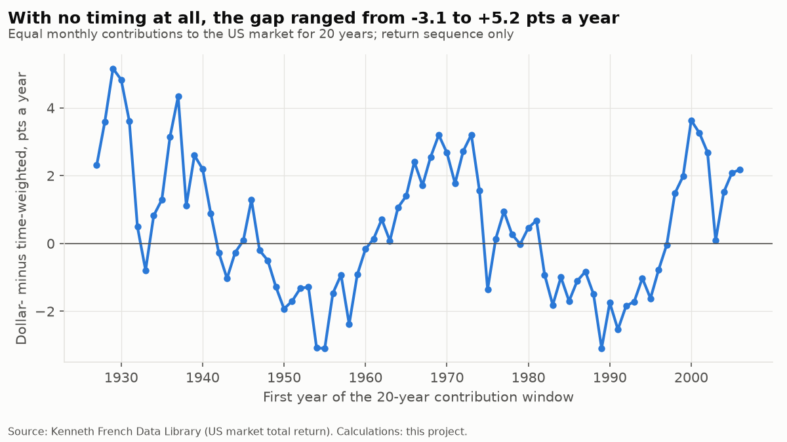

**Caveats**

- The illustration uses steady contributions to a US market index; real investors' flows, fund choice and fees differ.
- Literature summaries rely on publisher listings, abstracts and the authors' published exchanges; the full texts of the DALBAR reports (paid) were not reviewed.
- For this project's investor, the practical implication is behavioural: a rule-based rebalancing policy fixed in advance (claim 11, Phase 2) limits discretionary timing.

Table: windows

|  | time_weighted | dollar_weighted | gap |
|---|---|---|---|
| 1927 | 5.6% | 7.9% | 2.3% |
| 1928 | 4.3% | 7.9% | 3.6% |
| 1929 | 2.7% | 7.9% | 5.2% |
| 1930 | 4.5% | 9.3% | 4.8% |
| 1931 | 7.7% | 11.3% | 3.6% |
| 1932 | 11.9% | 12.4% | 0.5% |
| 1933 | 13.1% | 12.3% | -0.8% |
| 1934 | 10.6% | 11.5% | 0.8% |
| 1935 | 12.7% | 14.0% | 1.3% |
| 1936 | 11.9% | 15.1% | 3.1% |
| 1937 | 10.8% | 15.1% | 4.3% |
| 1938 | 12.6% | 13.7% | 1.1% |
| 1939 | 13.3% | 15.9% | 2.6% |
| 1940 | 13.8% | 16.0% | 2.2% |
| 1941 | 14.3% | 15.2% | 0.9% |
| 1942 | 16.3% | 16.1% | -0.3% |
| 1943 | 14.8% | 13.8% | -1.0% |
| 1944 | 14.5% | 14.2% | -0.3% |
| 1945 | 14.2% | 14.3% | 0.1% |
| 1946 | 13.2% | 14.4% | 1.3% |
| 1947 | 13.0% | 12.8% | -0.2% |
| 1948 | 14.2% | 13.7% | -0.5% |
| 1949 | 14.9% | 13.6% | -1.3% |
| 1950 | 13.2% | 11.3% | -1.9% |
| 1951 | 11.7% | 10.0% | -1.7% |
| 1952 | 11.5% | 10.2% | -1.3% |
| 1953 | 11.7% | 10.4% | -1.3% |
| 1954 | 10.4% | 7.4% | -3.1% |
| 1955 | 6.5% | 3.4% | -3.1% |
| 1956 | 7.0% | 5.5% | -1.5% |
| 1957 | 7.8% | 6.9% | -0.9% |
| 1958 | 8.2% | 5.9% | -2.4% |
| 1959 | 6.7% | 5.8% | -0.9% |
| 1960 | 7.2% | 7.0% | -0.2% |
| 1961 | 8.6% | 8.8% | 0.1% |
| 1962 | 7.2% | 7.9% | 0.7% |
| 1963 | 8.8% | 8.9% | 0.1% |
| 1964 | 8.9% | 9.9% | 1.1% |
| 1965 | 8.3% | 9.7% | 1.4% |
| 1966 | 9.1% | 11.5% | 2.4% |
| 1967 | 10.4% | 12.1% | 1.7% |
| 1968 | 9.1% | 11.7% | 2.6% |
| 1969 | 9.3% | 12.5% | 3.2% |
| 1970 | 11.3% | 14.0% | 2.7% |
| 1971 | 11.0% | 12.8% | 1.8% |
| 1972 | 11.8% | 14.5% | 2.7% |
| 1973 | 11.5% | 14.7% | 3.2% |
| 1974 | 13.3% | 14.8% | 1.6% |
| 1975 | 15.1% | 13.8% | -1.4% |
| 1976 | 15.1% | 15.2% | 0.1% |
| 1977 | 14.8% | 15.7% | 0.9% |
| 1978 | 16.5% | 16.8% | 0.3% |
| 1979 | 17.3% | 17.3% | -0.0% |
| 1980 | 17.4% | 17.9% | 0.5% |
| 1981 | 15.0% | 15.7% | 0.7% |
| 1982 | 14.6% | 13.6% | -0.9% |
| 1983 | 12.1% | 10.3% | -1.8% |
| 1984 | 12.5% | 11.5% | -1.0% |
| 1985 | 12.9% | 11.2% | -1.7% |
| 1986 | 11.7% | 10.6% | -1.1% |
| 1987 | 11.6% | 10.8% | -0.8% |
| 1988 | 11.9% | 10.4% | -1.5% |
| 1989 | 8.4% | 5.3% | -3.1% |
| 1990 | 8.4% | 6.7% | -1.7% |
| 1991 | 9.6% | 7.1% | -2.5% |
| 1992 | 8.0% | 6.2% | -1.8% |
| 1993 | 8.3% | 6.6% | -1.7% |
| 1994 | 9.4% | 8.4% | -1.0% |
| 1995 | 10.0% | 8.4% | -1.6% |
| 1996 | 8.3% | 7.6% | -0.8% |
| 1997 | 8.0% | 7.9% | -0.0% |
| 1998 | 7.6% | 9.1% | 1.5% |
| 1999 | 6.2% | 8.1% | 2.0% |
| 2000 | 6.4% | 10.0% | 3.6% |
| 2001 | 8.2% | 11.5% | 3.3% |
| 2002 | 10.0% | 12.7% | 2.7% |
| 2003 | 10.1% | 10.2% | 0.1% |
| 2004 | 9.9% | 11.4% | 1.5% |
| 2005 | 10.5% | 12.6% | 2.1% |
| 2006 | 11.1% | 13.2% | 2.2% |

## Sensitivity of verdicts to window choices

Window and horizon lengths with no cited source are rerun at alternatives either side of the default. 0 of 20 alternatives change a verdict.

| claim | parameter | value | default | statistic | verdict | changes_verdict |
|---|---|---|---|---|---|---|
| 3 | variance-ratio test horizon (years) | 10 |  | supported in 2 of 16 countries | Fails | no |
| 3 | variance-ratio test horizon (years) | 15 |  | supported in 2 of 16 countries | Fails | no |
| 3 | variance-ratio test horizon (years) | 20 | yes | supported in 0 of 16 countries | Fails | no |
| 4 | long horizon compared with 1 year (years) | 10 |  | 14 of 16 countries shift towards equities | Partially holds | no |
| 4 | long horizon compared with 1 year (years) | 15 |  | 13 of 16 countries shift towards equities | Partially holds | no |
| 4 | long horizon compared with 1 year (years) | 20 | yes | 13 of 16 countries shift towards equities | Partially holds | no |
| 4 | long horizon compared with 1 year (years) | 25 |  | 9 of 13 countries shift towards equities | Partially holds | no |
| 4 | long horizon compared with 1 year (years) | 30 |  | 8 of 12 countries shift towards equities | Partially holds | no |
| 5 | correlation window (months) | 24 |  | 14 of 32 blocks negative | Fails | no |
| 5 | correlation window (months) | 36 | yes | 8 of 21 blocks negative | Fails | no |
| 5 | correlation window (months) | 60 |  | 5 of 12 blocks negative | Fails | no |
| 5 | CPI publication lag (months) | 1 |  | high 0.32 vs low -0.18 | high > low | no |
| 5 | CPI publication lag (months) | 2 | yes | high 0.29 vs low -0.17 | high > low | no |
| 5 | CPI publication lag (months) | 3 |  | high 0.29 vs low -0.25 | high > low | no |
| 5 | regime burn-in (months) | 60 |  | high 0.29 vs low -0.17 | high > low | no |
| 5 | regime burn-in (months) | 120 | yes | high 0.29 vs low -0.17 | high > low | no |
| 5 | regime burn-in (months) | 180 |  | high 0.29 vs low -0.17 | high > low | no |
| 6 | comparison block (years) | 5 |  | 10y beat 5y in 7 of 12 blocks | Partially holds | no |
| 6 | comparison block (years) | 10 | yes | 10y beat 5y in 4 of 6 blocks | Partially holds | no |
| 6 | comparison block (years) | 15 |  | 10y beat 5y in 3 of 4 blocks | Partially holds | no |

The claim 5 burn-in alternatives give identical results because US CPI data start in 1947, so every burn-in ends before the February 1962 start of the return sample.
