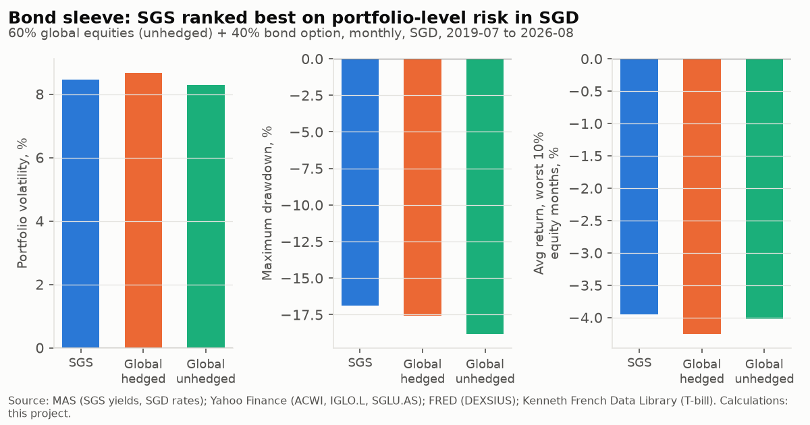
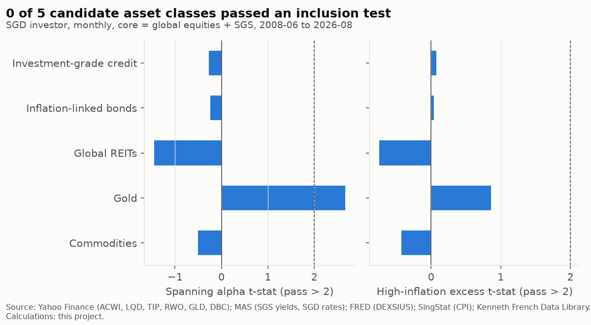
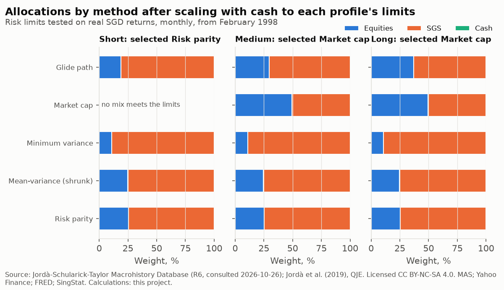

# Strategy design

Generated by `uv run python -m analysis.pipeline design`; do not edit by hand. Decisions and their reasons are logged in `docs/decisions.md`.

## Investor framing and horizon profiles

Spending money for near-term needs sits outside the strategy; its size is left to the investor. This separation of near-term spending money from long-horizon capital, and setting risk by the investor's capacity for each goal, follows the goals-based framing of Chhabra (2005, 'Beyond Markowitz', Journal of Wealth Management 7(4), 8–34) and Brunel (2015, Goals-Based Wealth Management, Wiley). Minimum allocation USD 25,000; daily-tradable ETFs only. Profiles are defined by risk capacity and tested on real SGD monthly returns from 1998; a GDP-weighted global JST portfolio (1871–2020) is a stress scenario.

**Current limits (v2, set after the v1 holdout, owner-approved 2026-10-27).** All measures are on real SGD returns over rolling windows of the profile's horizon. The short profile keeps a drawdown cap; medium and long use horizon measures (chance of a real loss, worst rolling real return) instead of peak-to-trough caps. Limits loosen with horizon in cumulative terms; the per-year floors tighten (-3.2%, -2.2%, -1.4% a year), which the owner accepted.

| Profile | Horizon | Purpose | Risk-capacity limits |
|---|---|---|---|
| Short | about 5 years | a known spend at a set date | Worst real SGD return over any 5-year period no worse than -15% cumulative; real loss in at most 10% of 5-year periods; peak-to-trough fall no worse than -20% |
| Medium | about 10 years | a flexible goal that could wait a few years | Worst real SGD return over any 10-year period no worse than -20% cumulative; real loss in at most 15% of 10-year periods |
| Long | 20+ years | wealth building with no planned withdrawals | Worst real SGD return over any 20-year period no worse than -25% cumulative; real loss in at most 20% of 20-year periods |

Superseded v1 limits, kept for the record of the v1 finding below:

| Profile | Horizon | Purpose | Risk-capacity limits |
|---|---|---|---|
| Short | about 5 years | a known spend at a set date | Worst real SGD return over any 5-year period no worse than -15% cumulative |
| Medium | about 10 years | a flexible goal that could wait a few years | Worst real SGD return over any 10-year period no worse than -20% cumulative |
| Long | 20+ years | wealth building with no planned withdrawals | Worst real SGD return over any 20-year period at least 0% a year; peak-to-trough fall no worse than -35% |

How the limits were set, stated plainly: the profiles are generic (no actual investor's spending amount, flexibility or reserve), so investor need could not produce numbers of its own. The v1 limits began as draft starting points adjusted by the owner, with the short limit loosened after history showed the first number could not be met; the v2 limits were set after the v1 holdout. Need is used to describe and check the limits, not to derive them.

## Core result: a risk menu per horizon

Decision rule (changed after the holdout, 2026-10-27): no single recommended portfolio. For each horizon and each maximum-drawdown tolerance (-20%, -30%, -40%, -50%), the menu shows the highest-expected-return equity/SGS mix (1-point steps) whose maximum real drawdown is no worse than the tolerance, with its chance of a real loss over the horizon, worst horizon real return and CVaR at 5% of horizon real returns. The loss-probability rule it replaces did not constrain equity at long horizons.

Definitions (fixed before the results were computed):

- Maximum drawdown: the worse of the real SGD monthly path (1998 onwards) and the US real monthly path from 1871 to 1980 (Shiller equities; bonds are a modelled US government bond duration-matched to A35, 8.18 years, priced from Shiller's long-rate yield with a flat curve, or the 30-year bond where yields are too high to reach that duration). Annual JST data are not used for drawdowns, because annual observations hide falls within a year. Drawdowns do not depend on the horizon, so the same mixes appear at every horizon; the horizon changes the loss measures.
- Nominal SGD drawdown (max_drawdown_sgd_nominal): the SGD path before inflation, shown for context only; it is not binding.
- Stress test, not binding: the drawdown with Shiller's long government bond in place of the proxy, January 1940 to December 1981 (stress_long_bond_1940_81).
- P(real loss): the highest real-loss share across the three holdout tests (H1 non-US JST windows pooled across countries, H2 US before 1981 with the proxy bond, H3 global JST block bootstrap).
- Worst horizon real return: the worst cumulative real return over any horizon-length window in the actual histories (H1 and H2).
- CVaR 5%: the average of the worst 5% of horizon real returns, the lowest of the three tests.
- Expected real return: the global JST portfolio's long-run real return.

### Short (about 5 years)

Risk menu:

|  | result | equity_share | expected_real_return | max_drawdown | max_drawdown_sgd | max_drawdown_sgd_nominal | max_drawdown_us_pre1981 | stress_long_bond_1940_81 | p_loss_holdout | worst_window_holdout | cvar5_holdout |
|---|---|---|---|---|---|---|---|---|---|---|---|
| Drawdown no worse than -20% | no mix | n/a | n/a | n/a | n/a | n/a | n/a | n/a | n/a | n/a | n/a |
| Drawdown no worse than -30% | no mix | n/a | n/a | n/a | n/a | n/a | n/a | n/a | n/a | n/a | n/a |
| Drawdown no worse than -40% | no mix | n/a | n/a | n/a | n/a | n/a | n/a | n/a | n/a | n/a | n/a |
| Drawdown no worse than -50% | meets tolerance | 59.0% | 5.4% | -49.4% | -35.4% | -30.1% | -49.4% | -36.6% | 22.1% | -92.7% | -57.8% |

Frontier (10-point steps):

| mix | expected_real_return | max_drawdown | max_drawdown_sgd | max_drawdown_sgd_nominal | max_drawdown_us_pre1981 | stress_long_bond_1940_81 | p_loss_holdout | worst_window_holdout | cvar5_holdout |
|---|---|---|---|---|---|---|---|---|---|
| 0% equity | 3.4% | -57.2% | -22.5% | -14.2% | -57.2% | -58.2% | 34.9% | -96.8% | -62.2% |
| 10% equity | 3.8% | -44.0% | -20.8% | -13.2% | -44.0% | -42.9% | 28.2% | -94.2% | -60.8% |
| 20% equity | 4.2% | -43.9% | -20.4% | -13.7% | -43.9% | -40.8% | 24.8% | -92.6% | -59.7% |
| 30% equity | 4.5% | -43.8% | -20.8% | -14.3% | -43.8% | -39.4% | 23.0% | -92.1% | -58.7% |
| 40% equity | 4.9% | -43.7% | -24.5% | -18.5% | -43.7% | -38.1% | 21.9% | -91.9% | -58.1% |
| 50% equity | 5.2% | -43.7% | -30.4% | -24.8% | -43.7% | -37.0% | 21.5% | -91.8% | -57.8% |
| 60% equity | 5.5% | -50.3% | -35.9% | -30.7% | -50.3% | -37.0% | 22.5% | -92.9% | -57.8% |
| 70% equity | 5.7% | -58.7% | -41.1% | -36.2% | -58.7% | -40.5% | 23.5% | -94.1% | -58.4% |
| 80% equity | 5.9% | -65.8% | -45.9% | -41.3% | -65.8% | -43.8% | 24.2% | -95.2% | -59.4% |
| 90% equity | 6.1% | -71.8% | -50.5% | -46.2% | -71.8% | -47.0% | 26.0% | -96.1% | -60.8% |
| 100% equity | 6.3% | -76.8% | -54.6% | -50.8% | -76.8% | -50.1% | 27.3% | -96.9% | -62.7% |

### Medium (about 10 years)

Risk menu:

|  | result | equity_share | expected_real_return | max_drawdown | max_drawdown_sgd | max_drawdown_sgd_nominal | max_drawdown_us_pre1981 | stress_long_bond_1940_81 | p_loss_holdout | worst_window_holdout | cvar5_holdout |
|---|---|---|---|---|---|---|---|---|---|---|---|
| Drawdown no worse than -20% | no mix | n/a | n/a | n/a | n/a | n/a | n/a | n/a | n/a | n/a | n/a |
| Drawdown no worse than -30% | no mix | n/a | n/a | n/a | n/a | n/a | n/a | n/a | n/a | n/a | n/a |
| Drawdown no worse than -40% | no mix | n/a | n/a | n/a | n/a | n/a | n/a | n/a | n/a | n/a | n/a |
| Drawdown no worse than -50% | meets tolerance | 59.0% | 5.4% | -49.4% | -35.4% | -30.1% | -49.4% | -36.6% | 16.6% | -94.4% | -70.8% |

Frontier (10-point steps):

| mix | expected_real_return | max_drawdown | max_drawdown_sgd | max_drawdown_sgd_nominal | max_drawdown_us_pre1981 | stress_long_bond_1940_81 | p_loss_holdout | worst_window_holdout | cvar5_holdout |
|---|---|---|---|---|---|---|---|---|---|
| 0% equity | 3.4% | -57.2% | -22.5% | -14.2% | -57.2% | -58.2% | 33.7% | -98.5% | -78.0% |
| 10% equity | 3.8% | -44.0% | -20.8% | -13.2% | -44.0% | -42.9% | 27.0% | -95.5% | -76.4% |
| 20% equity | 4.2% | -43.9% | -20.4% | -13.7% | -43.9% | -40.8% | 23.1% | -94.2% | -75.0% |
| 30% equity | 4.5% | -43.8% | -20.8% | -14.3% | -43.8% | -39.4% | 19.8% | -94.0% | -73.7% |
| 40% equity | 4.9% | -43.7% | -24.5% | -18.5% | -43.7% | -38.1% | 18.2% | -93.9% | -72.6% |
| 50% equity | 5.2% | -43.7% | -30.4% | -24.8% | -43.7% | -37.0% | 16.9% | -93.8% | -71.6% |
| 60% equity | 5.5% | -50.3% | -35.9% | -30.7% | -50.3% | -37.0% | 16.6% | -94.5% | -70.7% |
| 70% equity | 5.7% | -58.7% | -41.1% | -36.2% | -58.7% | -40.5% | 16.4% | -95.7% | -70.1% |
| 80% equity | 5.9% | -65.8% | -45.9% | -41.3% | -65.8% | -43.8% | 17.2% | -96.6% | -69.9% |
| 90% equity | 6.1% | -71.8% | -50.5% | -46.2% | -71.8% | -47.0% | 17.5% | -97.4% | -69.8% |
| 100% equity | 6.3% | -76.8% | -54.6% | -50.8% | -76.8% | -50.1% | 18.8% | -98.1% | -70.1% |

### Long (20+ years)

Risk menu:

|  | result | equity_share | expected_real_return | max_drawdown | max_drawdown_sgd | max_drawdown_sgd_nominal | max_drawdown_us_pre1981 | stress_long_bond_1940_81 | p_loss_holdout | worst_window_holdout | cvar5_holdout |
|---|---|---|---|---|---|---|---|---|---|---|---|
| Drawdown no worse than -20% | no mix | n/a | n/a | n/a | n/a | n/a | n/a | n/a | n/a | n/a | n/a |
| Drawdown no worse than -30% | no mix | n/a | n/a | n/a | n/a | n/a | n/a | n/a | n/a | n/a | n/a |
| Drawdown no worse than -40% | no mix | n/a | n/a | n/a | n/a | n/a | n/a | n/a | n/a | n/a | n/a |
| Drawdown no worse than -50% | meets tolerance | 59.0% | 5.4% | -49.4% | -35.4% | -30.1% | -49.4% | -36.6% | 15.9% | -92.1% | -74.7% |

Frontier (10-point steps):

| mix | expected_real_return | max_drawdown | max_drawdown_sgd | max_drawdown_sgd_nominal | max_drawdown_us_pre1981 | stress_long_bond_1940_81 | p_loss_holdout | worst_window_holdout | cvar5_holdout |
|---|---|---|---|---|---|---|---|---|---|
| 0% equity | 3.4% | -57.2% | -22.5% | -14.2% | -57.2% | -58.2% | 32.8% | -98.3% | -87.0% |
| 10% equity | 3.8% | -44.0% | -20.8% | -13.2% | -44.0% | -42.9% | 28.6% | -95.1% | -84.7% |
| 20% equity | 4.2% | -43.9% | -20.4% | -13.7% | -43.9% | -40.8% | 24.3% | -93.3% | -82.4% |
| 30% equity | 4.5% | -43.8% | -20.8% | -14.3% | -43.8% | -39.4% | 20.8% | -92.8% | -80.1% |
| 40% equity | 4.9% | -43.7% | -24.5% | -18.5% | -43.7% | -38.1% | 18.2% | -92.3% | -77.7% |
| 50% equity | 5.2% | -43.7% | -30.4% | -24.8% | -43.7% | -37.0% | 16.9% | -92.1% | -75.7% |
| 60% equity | 5.5% | -50.3% | -35.9% | -30.7% | -50.3% | -37.0% | 15.7% | -92.1% | -74.6% |
| 70% equity | 5.7% | -58.7% | -41.1% | -36.2% | -58.7% | -40.5% | 15.3% | -92.2% | -74.5% |
| 80% equity | 5.9% | -65.8% | -45.9% | -41.3% | -65.8% | -43.8% | 15.2% | -92.4% | -75.0% |
| 90% equity | 6.1% | -71.8% | -50.5% | -46.2% | -71.8% | -47.0% | 14.6% | -93.1% | -75.8% |
| 100% equity | 6.3% | -76.8% | -54.6% | -50.8% | -76.8% | -50.1% | 14.8% | -95.0% | -77.0% |

### Reading

No mix keeps the US 1871–1980 real drawdown better than -43.7% (the best is at 51% equities). The binding episodes: 0% equity: -57%, 1940-11 to 1980-03; 30% equity: -44%, 1915-12 to 1920-06; 51% equity: -44%, 1915-12 to 1920-06; 100% equity: -77%, 1929-09 to 1932-06. For every mix with at least 10% equities the worst US episode ends before 1940, so the 1940–81 bond losses (stress column) do not bind. Tolerances tighter than that floor have no mix. Lowest P(real loss) over the horizon across all mixes (1-point steps): short 21.5% at 48% equities; medium 16.3% at 62% equities; long 14.6% at 86% equities. The short horizon remains outside the strategy on the loss measures.

The worst horizon real returns come from the non-US JST histories, which include wars and hyperinflations. Worst windows: short, 0% equity: Germany to 1922 (-97%); short, 50% equity: Japan to 1945 (-92%); short, 100% equity: Portugal to 1978 (-97%); medium, 0% equity: Germany to 1922 (-98%); medium, 50% equity: France to 1951 (-94%); medium, 100% equity: Portugal to 1983 (-98%); long, 0% equity: Germany to 1922 (-98%); long, 50% equity: France to 1950 (-92%); long, 100% equity: Portugal to 1993 (-95%).

Sensitivity, not a selection: the largest equity share meeting each tolerance if only the SGD path (1998 onwards, in-sample) set the drawdown:

|  | equity_share | max_drawdown_sgd |
|---|---|---|
| Drawdown no worse than -20% | n/a | n/a |
| Drawdown no worse than -30% | 49.0% | -29.8% |
| Drawdown no worse than -40% | 67.0% | -39.6% |
| Drawdown no worse than -50% | 88.0% | -49.6% |

## Bond sleeve: SGS vs global hedged vs global unhedged

Rules fixed before computing (`analysis.design.bond_options`): three options at matched duration; 60% global equities unhedged in SGD plus 40% bond option, monthly, before costs; ranked on portfolio volatility, maximum drawdown and mean return in the worst 10% of equity months, all in SGD; lowest average rank in the main layer wins.

**Main layer, same fund (2019-07 to 2026-08).** Global government bonds: iShares Global Govt Bond UCITS ETF, unhedged (IGLO.L) and USD-hedged (SGLU.AS) classes. SGS matched to the fund's published effective duration of 6.27 years (SGS maturity 6.4–7.1 years).

|  | portfolio_volatility | portfolio_max_drawdown | worst10_equity_months_return | portfolio_return | portfolio_real_return | bond_volatility | bond_equity_correlation | average_rank |
|---|---|---|---|---|---|---|---|---|
| SGS | 8.5% | -16.9% | -4.0% | 8.3% | 5.5% | 4.5% | 0.26 | 1.33 |
| Global hedged to SGD | 8.7% | -17.6% | -4.3% | 7.1% | 4.4% | 4.6% | 0.38 | 2.67 |
| Global unhedged | 8.3% | -18.8% | -4.0% | 6.4% | 3.7% | 5.3% | 0.10 | 2.00 |

**Long layer (1998-02 to 2026-08).** US 10-year Treasury as the global stand-in; SGS matched to its duration each month.

|  | portfolio_volatility | portfolio_max_drawdown | worst10_equity_months_return | portfolio_return | portfolio_real_return | bond_volatility | bond_equity_correlation | average_rank |
|---|---|---|---|---|---|---|---|---|
| SGS | 8.2% | -30.5% | -4.0% | 6.0% | 4.2% | 6.4% | -0.10 | 3.00 |
| Global hedged to SGD | 7.9% | -29.4% | -3.7% | 5.7% | 4.0% | 7.4% | -0.24 | 2.00 |
| Global unhedged | 7.7% | -27.2% | -3.3% | 5.8% | 4.0% | 8.7% | -0.33 | 1.00 |

**Rule outcome: SGS.** Its portfolio-volatility difference from the runner-up (Global unhedged) has a 95% interval of -0.30% to +0.64% (includes zero). The long layer ranks Global unhedged first, the opposite. Sensitivity of the main-layer winner to the SGS duration: 5.0 years: SGS; 7.5 years: SGS.

**Decision (owner, 2026-10-27): follow the rule; the bond sleeve is SGS, logged as low confidence.** Phase 3 also backtests the global-unhedged sleeve to show how much the choice matters.

Caveats: the main layer is about seven years and includes 2022; the global fund's duration is a current published figure applied to the whole period (verified from the factsheet; `reference/bond_durations.csv`); SGS returns are built from benchmark yields, not a traded index; hedges assume covered interest parity; the long layer uses US Treasuries, not global bonds.

## Asset universe

Rules fixed before computing (`analysis.design.universe`): core = global equities (unhedged in SGD) + the SGS sleeve; cash is always available. A candidate joins if its spanning alpha over the core has HAC t > 2, or if it beats a core 60/40 in high-inflation months known at the time (Singapore CPI) with HAC t > 2, and it must have an economic source of expected return (cash flows or indexation). Fixed-income candidates are hedged to SGD; real assets are unhedged. Sample 2008-06 to 2026-08, monthly, SGD.

|  | annual_return | volatility | correlation_with_equity | spanning_alpha | spanning_t | high_inflation_months | high_inflation_excess_vs_core | high_inflation_t | return_source | passes_spanning | passes_inflation_role | included |
|---|---|---|---|---|---|---|---|---|---|---|---|---|
| Investment-grade credit | 3.6% | 8.4% | 0.42 | -0.3% | -0.27 | 85 | 0.3% | 0.08 | coupons; credit spread over government bonds | False | False | False |
| Inflation-linked bonds | 2.4% | 5.8% | 0.33 | -0.3% | -0.24 | 85 | 0.1% | 0.04 | real coupons plus inflation-indexed accrual | False | False | False |
| Global REITs | 3.5% | 17.2% | 0.79 | -4.0% | -1.45 | 85 | -3.9% | -0.75 | rents passed through as dividends | False | False | False |
| Gold | 8.4% | 16.0% | -0.10 | 8.4% | 2.67 | 85 | 6.0% | 0.86 | none | True | False | False |
| Commodities | -0.8% | 17.3% | 0.39 | -2.1% | -0.50 | 85 | -3.3% | -0.42 | none | False | False | False |

**Included by the rule: none. Excluded: Investment-grade credit, Inflation-linked bonds, Global REITs, Gold, Commodities.**

Gold robustness (annual, Damodaran, against US stocks and 10-year Treasuries): 1928–2025 alpha +4.6% a year (t = 1.4); 1972–2025, after the end of fixed gold prices, +9.6% (t = 1.8), real return 4.8% a year. Same direction as the monthly result but not significant at annual frequency. With five candidates tested, a stricter threshold of about t > 2.33 (one-sided 5% divided by 5) is reported for reference.

Roles and sources of expected return:

- Global equities: growth; the equity risk premium (claim 1).
- SGS: risk reduction in SGD; term premium and income (claims 5, 6; bond-sleeve test).
- Cash (SGD one-month rate): liquidity; the short profile's anchor.
- Gold: excluded. It passed the spanning test, but has no economic source of expected return (no cash flows); the return-source condition was added after the first results, at the owner's direction: the owner's judgement is that assets without cash flows lack a reliable expected real return, consistent with the long-run annual tests (not significant) and with Erb and Harvey (2013) (docs/decisions.md).
- Excluded classes and the evidence: investment-grade credit (claim 7: equity-like risk, premium not reliable after defaults), inflation-linked bonds (claim 8: real-yield moves dominate over one-year horizons), REITs (claim 9: no return added at equal risk), commodities (failed both tests).

## Allocation methods and selection

Rules fixed before computing (`analysis.design.allocation`): five methods give risky weights over global equities and SGS; each profile holds the largest share of that mix (rest in SGD cash) that meets its limits on real SGD history (1998-02 to 2026-08); expected real return is the long-run real return of a GDP-weighted global portfolio of the JST countries (1871–2020, real USD, bonds hedged), which is also reported as a stress scenario; per profile the highest expected real return wins. Estimated methods use monthly SGD data (2008-06 to 2026-08).

**Selected under the earlier rule (superseded by the risk menu; docs/decisions.md, 2026-10-27):** Short: none feasible; Medium: Market cap; Long: Market cap.

| profile | method | share_in_risky_mix | w_equity | w_bonds | w_cash | expected_real_return | worst_window_sgd | max_drawdown_sgd | sgd_real_return | sgd_volatility | meets_limits | worst_window_global | max_drawdown_global | global_stress_passes |
|---|---|---|---|---|---|---|---|---|---|---|---|---|---|---|
| Short | Glide path | n/a | 0.0% | 0.0% | 100.0% | 2.1% | -16.6% | -24.9% | -0.6% | 1.7% | False | -38.9% | -39.8% | False |
| Short | Market cap | n/a | 0.0% | 0.0% | 100.0% | 2.1% | -16.6% | -24.9% | -0.6% | 1.7% | False | -38.9% | -39.8% | False |
| Short | Minimum variance | n/a | 0.0% | 0.0% | 100.0% | 2.1% | -16.6% | -24.9% | -0.6% | 1.7% | False | -38.9% | -39.8% | False |
| Short | Mean-variance (shrunk) | n/a | 0.0% | 0.0% | 100.0% | 2.1% | -16.6% | -24.9% | -0.6% | 1.7% | False | -38.9% | -39.8% | False |
| Short | Risk parity | n/a | 0.0% | 0.0% | 100.0% | 2.1% | -16.6% | -24.9% | -0.6% | 1.7% | False | -38.9% | -39.8% | False |
| Medium | Glide path | 100.0% | 29.5% | 70.5% | 0.0% | 4.5% | 3.7% | -20.8% | 2.6% | 5.4% | True | -45.4% | -47.0% | False |
| Medium | Market cap | 100.0% | 49.5% | 50.5% | 0.0% | 5.2% | 3.3% | -30.1% | 3.5% | 7.2% | True | -46.9% | -49.1% | False |
| Medium | Minimum variance | 100.0% | 10.9% | 89.1% | 0.0% | 3.8% | -2.6% | -20.7% | 1.7% | 4.7% | True | -44.2% | -45.5% | False |
| Medium | Mean-variance (shrunk) | 100.0% | 24.7% | 75.3% | 0.0% | 4.4% | 2.1% | -20.6% | 2.4% | 5.1% | True | -45.0% | -46.6% | False |
| Medium | Risk parity | 100.0% | 25.4% | 74.6% | 0.0% | 4.4% | 2.4% | -20.6% | 2.4% | 5.1% | True | -45.1% | -46.7% | False |
| Long | Glide path | 100.0% | 37.0% | 63.0% | 0.0% | 4.8% | 42.5% | -22.6% | 3.0% | 6.0% | True | -18.4% | -47.7% | True |
| Long | Market cap | 100.0% | 49.5% | 50.5% | 0.0% | 5.2% | 45.7% | -30.1% | 3.5% | 7.2% | True | -16.8% | -49.1% | True |
| Long | Minimum variance | 100.0% | 10.9% | 89.1% | 0.0% | 3.8% | 4.2% | -20.7% | 1.7% | 4.7% | True | -22.3% | -45.5% | True |
| Long | Mean-variance (shrunk) | 100.0% | 24.7% | 75.3% | 0.0% | 4.4% | 24.1% | -20.6% | 2.4% | 5.1% | True | -20.2% | -46.6% | True |
| Long | Risk parity | 100.0% | 25.4% | 74.6% | 0.0% | 4.4% | 25.3% | -20.6% | 2.4% | 5.1% | True | -20.1% | -46.7% | True |

Weight sensitivity (5th–95th percentile over 2,000 moving-block bootstrap resamples of the monthly data):

| method | equity_p5 | bonds_p5 | equity_p95 | bonds_p95 |
|---|---|---|---|---|
| Mean-variance (shrunk) | 10.9% | 0.0% | 100.0% | 89.1% |
| Minimum variance | 7.2% | 85.7% | 14.3% | 92.8% |
| Risk parity | 23.3% | 50.0% | 50.0% | 76.7% |

Glide-path equity weight, interquartile range across JST countries: Short: 10%–26%; Medium: 21%–53%; Long: 18%–82%.

Caveats: SGD cash lost purchasing power in parts of the sample, so mixing a risky portfolio with cash does not always reduce real risk; methods that failed a limit at full weight ended at all cash, which can fail too (shown as not meeting limits). The SGD history is about 28 years without an SGD inflation crisis. The global stress columns show the same allocations on 1871–2020: every allocation, cash included, fails the limits there because of the First World War and 1940s inflation (global bonds -43% real over the five years to 1920). Mean-variance weights are unstable across resamples.

## Weights within asset classes, currency policy and rebalancing

**Within equities.** Hold one global market-cap-weighted equity index (developed and emerging markets) rather than fixed regional weights. The index provider updates country weights; no regional weight is hard-coded. At each annual review, the fund's published regional weights are recorded with their date in `reference/`.

**Within SGS.** Market-value weights of a Singapore government bond index, with the sleeve's duration kept near the matched duration used in the bond-sleeve test (the fund choice is made in Phase 4).

**Currency policy.** Equities unhedged; SGS needs no hedge (SGD). Evidence (claim 12): US equities: volatility in SGD 14.7% unhedged vs 15.5% hedged, real return difference +0.2% a year (t = 0.2); Developed-market equities: volatility in SGD 13.2% unhedged vs 15.0% hedged, real return difference +0.1% a year (t = 0.1). Hedging equities to SGD raised volatility without a significant change in return, so equities stay unhedged. If global bonds replace SGS (Phase 3 sensitivity), they are hedged to SGD.

**Rebalancing rule (fixed now, before any Phase 3 backtest).** Rebalance to target once a year at the end of December, and also at any month-end when the equity weight is more than 10 percentage points from target. Rationale: in claim 11 the rules could not be told apart before costs, so the rule is chosen on economic grounds: few trades (minimum broker fees make small, frequent trades expensive at the USD 25,000 minimum) and a cap on drift away from the profile's risk level. Evidence, US 60/40 1962–2026 after costs: annual 0.016% a year in costs, volatility 10.0%; ±10-point band 0.003%, volatility 10.3%; monthly 0.194%, volatility 10.1%. Phase 3 tests the rule's sensitivity without changing it.

## Finding: the v1 limits were infeasible on long history

Under the v1 limits, no allocation, all cash included, met the limits on the worst single JST country, nor on the GDP-weighted global portfolio over 1871–2020. The table shows the worst window (cumulative, or a year for the long profile's 0% floor) against each v1 floor. War and hyperinflation wiped out home-currency bonds and cash in single countries, and the world-war periods dragged down the global portfolio (see claims 1 and 2 of the evidence review). Testing on SGD history alone, then a holdout with a tie-break that always chose the safest near-tie, merged the three profiles into one; that result was not accepted as final and led to the v2 limits.

|  | v1_floor | worst_single_country | global_portfolio |
|---|---|---|---|
| ('Short', '100% cash') | -15.0% | -97.9% | -38.9% |
| ('Short', '0/100') | -15.0% | -96.8% | -43.2% |
| ('Short', '25/75') | -15.0% | -92.1% | -46.0% |
| ('Short', '50/50') | -15.0% | -91.8% | -49.1% |
| ('Short', '75/25') | -15.0% | -94.7% | -52.4% |
| ('Short', '100/0') | -15.0% | -96.9% | -56.0% |
| ('Medium', '100% cash') | -20.0% | -99.0% | -37.1% |
| ('Medium', '0/100') | -20.0% | -98.5% | -43.6% |
| ('Medium', '25/75') | -20.0% | -94.1% | -45.1% |
| ('Medium', '50/50') | -20.0% | -93.8% | -46.9% |
| ('Medium', '75/25') | -20.0% | -96.2% | -49.2% |
| ('Medium', '100/0') | -20.0% | -98.1% | -52.5% |
| ('Long', '100% cash') | 0.0% | -19.7% | -2.2% |
| ('Long', '0/100') | 0.0% | -18.5% | -1.8% |
| ('Long', '25/75') | 0.0% | -12.5% | -1.1% |
| ('Long', '50/50') | 0.0% | -11.9% | -0.9% |
| ('Long', '75/25') | 0.0% | -12.0% | -0.8% |
| ('Long', '100/0') | 0.0% | -13.9% | -0.9% |

## Holdout evaluation (v2)

The in-sample selection uses SGD history that overlaps the backtest. Each candidate that meets the v2 limits on SGD history, plus 'Maximum equity meeting limits' (largest equity share meeting them, rest SGS, labelled post-backtest), is scored on data not used to choose it: the share of horizon-length windows with a real loss in H1 pooled non-US JST countries (annual, local currency), H2 US data before 1981 (Shiller monthly), and H3 2,000 block-bootstrapped paths (3-year blocks) of the global JST portfolio. A candidate passes if all three are within the profile's loss tolerance; among passing candidates the highest expected real return wins; if none pass, the profile is infeasible (no tie-break).

| profile | candidate | w_equity | w_bonds | w_cash | tolerance | h1_non_us_loss_share | h2_us_pre1981_loss_share | h3_bootstrap_loss_share | passes_holdout | expected_real_return |
|---|---|---|---|---|---|---|---|---|---|---|
| Medium | Glide path | 29.5% | 70.5% | 0.0% | 15.0% | 19.9% | 18.2% | 8.3% | False | 4.5% |
| Medium | Market cap | 49.5% | 50.5% | 0.0% | 15.0% | 16.9% | 13.6% | 8.4% | False | 5.2% |
| Medium | Minimum variance | 10.9% | 89.1% | 0.0% | 15.0% | 26.8% | 26.2% | 9.7% | False | 3.8% |
| Medium | Mean-variance (shrunk) | 24.7% | 75.3% | 0.0% | 15.0% | 21.3% | 18.8% | 8.8% | False | 4.4% |
| Medium | Risk parity | 25.4% | 74.6% | 0.0% | 15.0% | 20.9% | 18.7% | 8.6% | False | 4.4% |
| Medium | Maximum equity meeting limits (post-backtest) | 87.0% | 13.0% | 0.0% | 15.0% | 17.6% | 10.8% | 10.9% | False | 6.1% |
| Long | Glide path | 37.0% | 63.0% | 0.0% | 20.0% | 18.8% | 2.0% | 3.1% | True | 4.8% |
| Long | Market cap | 49.5% | 50.5% | 0.0% | 20.0% | 16.9% | 0.9% | 3.2% | True | 5.2% |
| Long | Minimum variance | 10.9% | 89.1% | 0.0% | 20.0% | 28.3% | 14.0% | 3.8% | False | 3.8% |
| Long | Mean-variance (shrunk) | 24.7% | 75.3% | 0.0% | 20.0% | 22.3% | 4.9% | 3.0% | False | 4.4% |
| Long | Risk parity | 25.4% | 74.6% | 0.0% | 20.0% | 22.2% | 4.7% | 3.0% | False | 4.4% |
| Long | Maximum equity meeting limits (post-backtest) | 100.0% | 0.0% | 0.0% | 20.0% | 14.8% | 0.1% | 7.0% | True | 6.3% |

**Result under the v2 rule (superseded by the risk menu; docs/decisions.md, 2026-10-27):** Short: infeasible; Medium: infeasible; Long: Maximum equity meeting limits (post-backtest).

Infeasible profiles: Short, Medium. The table below shows every measure for equity/SGS mixes in 10-point steps, so the binding limit is visible.

|  | sgd_worst_window | sgd_loss_share | sgd_max_drawdown | meets_in_sample | h1_non_us_loss_share | h2_us_pre1981_loss_share | h3_bootstrap_loss_share |
|---|---|---|---|---|---|---|---|
| ('Short', '0% equity') | -14.6% | 41.2% | -22.5% | False | 28.6% | 35.3% | 17.0% |
| ('Short', '10% equity') | -9.5% | 34.9% | -20.8% | False | 26.1% | 28.4% | 14.2% |
| ('Short', '20% equity') | -8.7% | 26.4% | -20.4% | False | 23.9% | 24.8% | 13.1% |
| ('Short', '30% equity') | -13.2% | 14.8% | -20.8% | False | 23.0% | 21.3% | 13.2% |
| ('Short', '40% equity') | -17.6% | 15.5% | -24.5% | False | 21.9% | 19.8% | 13.2% |
| ('Short', '50% equity') | -22.0% | 18.3% | -30.4% | False | 21.5% | 17.5% | 13.4% |
| ('Short', '60% equity') | -26.2% | 19.0% | -35.9% | False | 22.5% | 16.4% | 13.9% |
| ('Short', '70% equity') | -30.4% | 20.1% | -41.1% | False | 23.5% | 16.5% | 15.0% |
| ('Short', '80% equity') | -34.5% | 22.5% | -45.9% | False | 24.2% | 17.5% | 16.1% |
| ('Short', '90% equity') | -38.5% | 25.7% | -50.5% | False | 26.0% | 17.9% | 17.0% |
| ('Short', '100% equity') | -42.3% | 28.2% | -54.6% | False | 27.3% | 18.5% | 18.2% |
| ('Medium', '0% equity') | -12.2% | 36.6% | -22.5% | False | 29.4% | 33.1% | 10.9% |
| ('Medium', '10% equity') | -2.9% | 5.8% | -20.8% | True | 27.0% | 26.6% | 9.8% |
| ('Medium', '20% equity') | 0.6% | 0.0% | -20.4% | True | 23.1% | 19.4% | 9.1% |
| ('Medium', '30% equity') | 3.8% | 0.0% | -20.8% | True | 19.8% | 18.2% | 8.2% |
| ('Medium', '40% equity') | 5.6% | 0.0% | -24.5% | True | 18.2% | 15.2% | 8.5% |
| ('Medium', '50% equity') | 3.0% | 0.0% | -30.4% | True | 16.9% | 13.5% | 8.3% |
| ('Medium', '60% equity') | -3.2% | 2.7% | -35.9% | True | 16.6% | 11.8% | 8.6% |
| ('Medium', '70% equity') | -9.4% | 7.1% | -41.1% | True | 16.4% | 11.3% | 9.3% |
| ('Medium', '80% equity') | -15.7% | 11.2% | -45.9% | True | 17.2% | 10.8% | 10.2% |
| ('Medium', '90% equity') | -21.8% | 14.7% | -50.5% | False | 17.5% | 10.8% | 11.2% |
| ('Medium', '100% equity') | -27.6% | 17.4% | -54.6% | False | 18.8% | 11.2% | 12.4% |
| ('Long', '0% equity') | -9.8% | 31.7% | -22.5% | False | 32.8% | 30.6% | 5.3% |
| ('Long', '10% equity') | 3.0% | 0.0% | -20.8% | True | 28.6% | 15.0% | 3.9% |
| ('Long', '20% equity') | 17.1% | 0.0% | -20.4% | True | 24.3% | 5.2% | 3.1% |
| ('Long', '30% equity') | 32.6% | 0.0% | -20.8% | True | 20.8% | 3.3% | 2.9% |
| ('Long', '40% equity') | 45.6% | 0.0% | -24.5% | True | 18.2% | 1.7% | 3.1% |
| ('Long', '50% equity') | 45.7% | 0.0% | -30.4% | True | 16.9% | 0.8% | 3.4% |
| ('Long', '60% equity') | 45.2% | 0.0% | -35.9% | True | 15.7% | 0.6% | 4.0% |
| ('Long', '70% equity') | 43.9% | 0.0% | -41.1% | True | 15.3% | 0.4% | 4.5% |
| ('Long', '80% equity') | 41.9% | 0.0% | -45.9% | True | 15.2% | 0.2% | 5.3% |
| ('Long', '90% equity') | 39.3% | 0.0% | -50.5% | True | 14.6% | 0.1% | 6.1% |
| ('Long', '100% equity') | 36.0% | 0.0% | -54.6% | True | 14.8% | 0.1% | 7.0% |

- Short: meets the limits in-sample at no mix; meets them in-sample and on all three holdout tests at no mix (lowest non-US loss share 21.5% against a tolerance of 10%).
- Medium: meets the limits in-sample at 10% equity to 80% equity; meets them in-sample and on all three holdout tests at no mix (lowest non-US loss share 16.4% against a tolerance of 15%).
- Long: meets the limits in-sample at 10% equity to 100% equity; meets them in-sample and on all three holdout tests at 40% equity to 100% equity (lowest non-US loss share 14.6% against a tolerance of 20%).